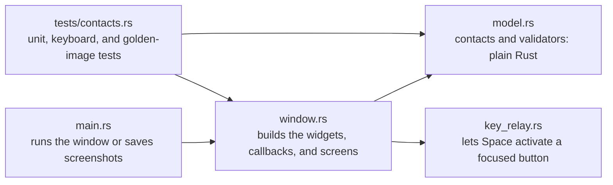

# Reference application

The reference application is a contact-card editor built only with Pushrod. It lives in the repository as the `contacts` example, and every MVP stage updates it, so it shows how the widgets, layouts, dialogs, keyboard handling, and high-DPI drawing work **together** in a real window. Problems that a one-widget demo hides (focus order, a dialog inside a resizable layout, keyboard access to every control) show up here first.


Run it with:

```sh
cargo run -p pushrod-sdl2 --example contacts
```

All of its data is fictional (Jane Doe, `jane.doe@example.com`, Anytown, and telephone numbers in the `555-01xx` range).

## What it exercises

| Requirement | How the application does it |
| --- | --- |
| A scrollable list | A [`Container`](../widgets/container.md) whose content is a column of radio buttons, one per contact |
| Text fields with validation | A required name, an e-mail address checked as it is typed, and a telephone [mask](../widgets/text-field.md) |
| Check boxes, radio buttons, a slider | **Favorite** and **Send the newsletter**; **Reach by** Email, Phone, or Mail; **Closeness** from 0 to 5 |
| Default and cancel buttons | **Save** answers Return and **Revert** answers Escape |
| An alert | **Delete...** asks for confirmation with `ui.alert` |
| Keyboard navigation | Tab and Shift-Tab reach every control; the arrow keys move within the list and the radio group |
| Window resizing | Every container has a layout, so the list grows taller and the fields grow wider |
| High-DPI rendering | Everything is drawn at the display's resolution; the lower right corner shows the window size and scale |

## How it is organized

The example is a folder, `pushrod-sdl2/examples/contacts/`, with one module per concern:



- **`model.rs`** holds the `ContactBook` (the contacts and which one is selected) and the validators. It knows nothing about widgets, so it is tested on its own.
- **`window.rs`** builds the window with `build(size, &app)` and returns the `Engine` and the IDs of every widget the callbacks change. The helpers that copy between the book and the widgets take a `WidgetCache`, so they run the same while the window is being built and inside callbacks (`ui.widgets()`).
- **`main.rs`** runs the window, or draws screens to images (see [Testing it](#testing-it)).

## Walkthrough

### The data and its validators

A validator judges the whole text of a field after each edit. `Invalid` refuses the edit; `Intermediate` allows it but means "not finished yet". The e-mail validator refuses spaces and a second `@`, and calls anything else that is not a complete address `Intermediate`:

```rust checked title="src/email.rs"
use pushrod_widgets::text_field::validate::{Validator, Validity};

/// Judges an e-mail address as it is typed: `name@domain.tld`, or empty.
#[derive(Debug, Default, Clone, Copy)]
pub struct EmailValidator;

impl Validator for EmailValidator {
    fn validate(&self, text: &str) -> Validity {
        if text.is_empty() {
            return Validity::Valid;
        }

        if text.chars().any(char::is_whitespace) || text.matches('@').count() > 1 {
            return Validity::Invalid;
        }

        let Some((local, domain)) = text.split_once('@') else {
            return Validity::Intermediate;
        };
        let complete = !local.is_empty()
            && domain
                .rsplit_once('.')
                .is_some_and(|(host, tld)| !host.is_empty() && tld.len() >= 2);

        if complete {
            Validity::Valid
        } else {
            Validity::Intermediate
        }
    }
}
```

The fields use it, a `RequiredValidator` for the name, and a mask for the telephone number:

```rust
let name = add_field(&mut engine, form, TextField::new().with_validator(RequiredValidator));
let email = add_field(&mut engine, form, TextField::new().with_validator(EmailValidator));
let phone = add_field(&mut engine, form, TextField::new().with_mask("(999) 999-9999"));
```

A field draws `Intermediate` text like any other, so after every `TextChanged` the application checks the whole form, shows what is missing under it, and disables **Save**:

```rust
for field in [ids.name, ids.email, ids.phone] {
    engine.on_text_change(field, move |_app, ui| refresh_controls(ui.widgets(), ids));
}
```


### A window that resizes

A resizable window gives its root a layout, so the root's children follow the window's size. Here the root's layout is a small custom one: its first child, a panel holding a [column](../layouts/row-and-column.md) of everything else, fills the window, and any later child is centered. An alert opened with `ui.alert` is added to the root, so it is centered over the window instead of being placed in the column:

```rust checked title="src/window_layout.rs"
use pushrod::geometry::{Rect, Size};
use pushrod::layout::{ChildInfo, Layout, SizeHint};

/// The first child fills the window; every later child is centered at its preferred size.
#[derive(Debug, Clone, Copy, Default)]
pub struct WindowLayout;

impl Layout for WindowLayout {
    fn measure(&self, children: &[ChildInfo], _available: Size) -> SizeHint {
        children.first().map_or_else(SizeHint::default, |main| main.hint)
    }

    fn arrange(&self, children: &[ChildInfo], bounds: Rect) -> Vec<Rect> {
        children
            .iter()
            .enumerate()
            .map(|(index, child)| {
                if index == 0 {
                    return bounds;
                }

                let Size { w, h } = child.hint.preferred;

                Rect::new(
                    bounds.x + (bounds.w as i32 - w as i32) / 2,
                    bounds.y + (bounds.h as i32 - h as i32) / 2,
                    w,
                    h,
                )
            })
            .collect()
    }
}
```

Inside the column, the body is a row with a stretch of `1`: the list keeps its width and fills the height, and the form (a [form layout](../layouts/form-layout.md)) takes the rest of the width. The form's panel starts at a realistic width (`Panel::new().size(400, 300)`), because a form layout measures itself at its container's current width and stacks its labels above the fields when that is narrow.


### The scrolling list

The list is a `Container` whose content follows the viewport's width and is as tall as its rows. Each row is a radio button, so the rows form one group: Tab visits the list once (at the selected row), and the arrow keys move the selection. The list's own size hint lets it shrink to 80 pixels and grow without limit:

```rust
let list = add(
    engine,
    parent,
    Container::new(point(0, 0), size(200, 200), size(0, 0))
        .content_mode(ContentSize::FollowWidth { fit_height: true }),
    LayoutParams {
        alignment: Alignment::new(Align::Start, Align::Fill),
        ..LayoutParams::default()
    },
);

if let Some(widget) = engine.widgets().get_mut(list) {
    widget.set_size_hint(SizeHint::new(size(200, 80), size(200, 200), size(200, u32::MAX)));
}
```

Tab order follows `WidgetId`s, the order widgets were added, so a row added later would be visited after the buttons. The list therefore makes all of its rows (up to 16) up front and hides the ones it does not need; a hidden widget takes no space in a layout and cannot take the focus.

### Default and cancel buttons, and the keyboard

**Save** is the default button (`default_action`, Return) and **Revert** the cancel button (`cancel_action`, Escape), so the whole form can be finished from any field. Buttons do not take the keyboard focus by default; the application makes its four buttons focusable so Tab reaches **New** and **Delete...** too. A button ignores keys, so their parent is a small `KeyRelay` container that passes key presses on, and the application runs the same action for a click or for Space:

```rust
for (button, action) in actions {
    if let Some(widget) = engine.widgets().get_mut(button) {
        widget.set_behavior(widget.behavior() | Behavior::FOCUSABLE);
    }

    engine.on_click(button, move |app, ui| action(app, ui, ids));
    engine.on_key_press(button, move |app, ui, key, _modifiers| {
        if key == Key::Char(' ') {
            action(app, ui, ids);
        }
    });
}
```

| Key | Does |
| --- | --- |
| Tab, Shift-Tab | Move between the list, each field, the **Reach by** group, the check boxes, the slider, and the buttons |
| Up, Down (in the list) | Select the previous or next contact |
| Left, Right | Choose **Reach by**; move the slider |
| Space | Toggle a check box; press the focused button |
| Return | **Save** (or the alert's **Delete**) |
| Escape | **Revert** (or the alert's **Cancel**) |

### Confirming a delete

**Delete...** opens an [alert](../widgets/alert.md). While it is open the window behind it is darkened, blurred, and inert. **Delete** is its default button and **Cancel** answers Escape:

```rust
ui.alert(
    AlertKind::Warning,
    &format!("Delete \"{}\"?", contact.name),
    "The contact card is removed from the list. This cannot be undone.",
    &["Delete", "Cancel"],
    0,
    move |app, ui, choice| {
        let removed = if choice == 0 { app.book.delete_selected() } else { None };
        // ... update the list, the form, and the status line.
    },
);
```


### High-DPI and the window size

The window is opened with `resizable` set, and the SDL2 backend always asks for a high-DPI drawing area. The application only listens: `ScaleFactorChanged` and the root's `LayoutChanged` engine events update the line in the lower right corner. Drag a window edge, or move the window to a display with another pixel density, to see both change.

## Testing it

`pushrod-sdl2/tests/contacts.rs` includes the example's modules and tests them three ways:

- **The book and validators**, as plain Rust.
- **The window**, built exactly as the example builds it, laid out with the headless backend, and driven with key presses and clicks: Tab order, list selection with the arrow keys, validation, Return and Escape, the delete alert, and resizing.
- **Golden images** of the four screens above, compared like the [widget goldens](../contributing/golden-image-rendering-tests.md):

```sh
PUSHROD_GOLDEN=1 cargo test -p pushrod-sdl2 --test contacts   # compare
UPDATE_GOLDEN=1 cargo test -p pushrod-sdl2 --test contacts    # rewrite after an intended change
```

The example draws the same screens into files, which is how the screenshots on this page are made:

```sh
cargo run -p pushrod-sdl2 --example contacts -- --screenshots pushrod-docs/static/img/screenshots
cargo run -p pushrod-sdl2 --example contacts -- --screenshot main.png delete
```

`--screenshot` takes `invalid`, `delete`, or `resized` after the file name; without one it draws the main screen.

## What building it found

Every workaround above marks something the library should make easier. Each is a candidate issue:

- An alert opened over a root that has a layout is arranged as one of the layout's children (worked around with `WindowLayout`).
- Buttons cannot take the keyboard focus or be pressed with Space, and do not pass key presses to `on_key_press` (worked around with `KeyRelay`).
- A form layout in a new container measures its stacked height, and `set_size_hint` is ignored for a container with a layout (worked around with a starting size).
- Tab order follows `WidgetId`s, so widgets added at run time come last (worked around with a pool of rows).
- A text field shows no sign of `Intermediate` input (worked around with a message under the form).
- There is no list widget yet; the [list view](https://github.com/KenSuenobu/rust-pushrod/issues/52) is planned.

## Next: loading the window from a form file

In the v0.2 stage the same window will be loaded from a form file instead of being built in code. That waits for the [form loader](https://github.com/KenSuenobu/rust-pushrod/issues/63).
