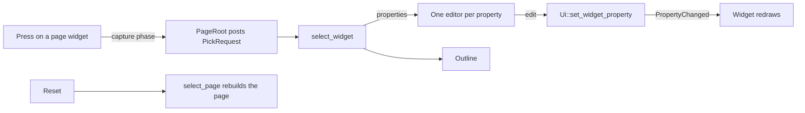
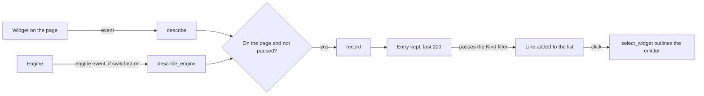
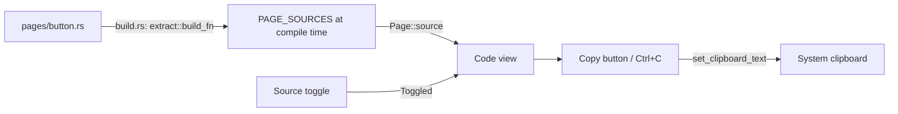
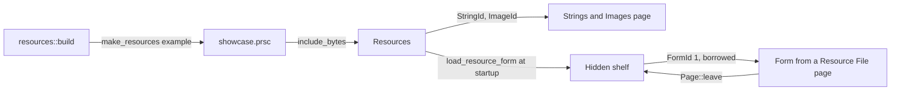
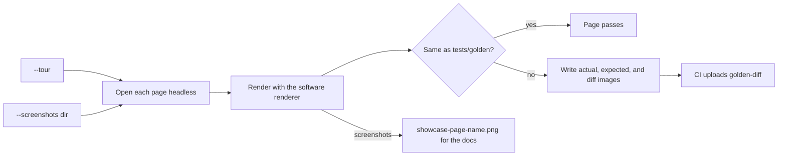
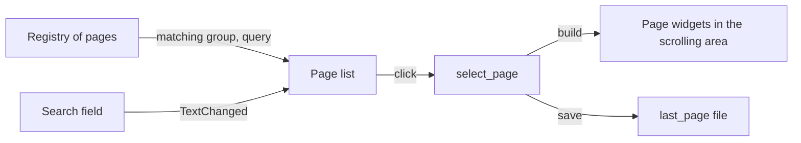
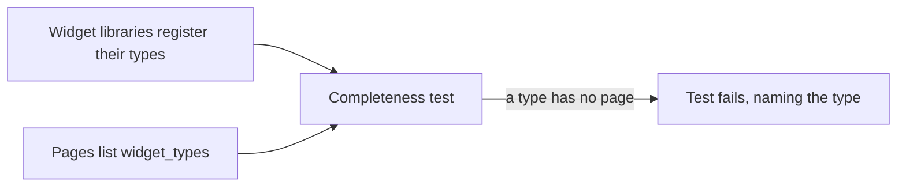

# The Pushrod Showcase

The showcase is one window that shows what Pushrod can do. The left side has a search field and the list of pages, grouped under **Core**, **Standard widgets**, **Layouts**, **Forms and resources**, and **Extra widgets**. The right side shows the selected page, with its title and a one-line description, inside a scrolling area.


Run it from the repository root:

```sh
cargo run -p pushrod-showcase
```

## Using it

- **Click a page** in the list to open it. The selected page stays pressed.
- **Type in the Search field** to filter the list. A page matches when what you typed (any case) appears in its name or its description. Groups with no match disappear; with no match at all, the list says **No pages match.**
- **Resize the window.** The list keeps its width and the page area takes the rest.
- **Close and reopen it.** The last page is remembered in `$XDG_CONFIG_HOME/pushrod-showcase/last_page` (or `~/.config/pushrod-showcase/last_page`).

## Changing a property live

On the right of the window is the **Properties** panel, a column with the heading at the top, one row per property (name on the left, editor on the right), the status line, and **Reset** at the bottom. It starts empty: *Click a widget on the page to select it.*


- **Click any widget on the page** to select it. An outline is drawn around it and the panel lists every property the widget reports through introspection (`Widget::properties`), so it works for any registered widget with no code for that widget.
- **Edit a property.** The editor depends on the kind of value:

| Kind | Editor |
| --- | --- |
| True or false (`enabled`, `hidden`) | A check box. |
| Whole or fractional number (`x`, `width`, `value`) | A text field. The widget changes as soon as the text is a valid number; half-typed text such as `-` is ignored until it is. |
| Text (`tooltip`) | A text field. |
| Color (`color`) | A text field holding `#rrggbb` or `#rrggbbaa`. |
| A choice (`align_horizontal`, `align_vertical`) | A button; each click shows the next of `start`, `center`, `end`, `fill`. |

- The status line above **Reset** reports `Set <name>.` after an edit, or the error when the widget refuses the value (for example a width that is out of range).
- **Click Reset** to rebuild the page and clear the selection. Opening another page does the same.

Each edit goes through `Ui::set_widget_property`, so it emits a `PropertyChanged` engine event like any other property change. The panel is `pushrod-showcase/src/property_panel.rs`.



The page root (`PageRoot`) sees presses before the widget under the pointer, so a widget that consumes its own press, such as a slider, can still be selected.

## Watching the events

Under the page is the **Events** log. Pushrod's widgets are driven by events, and the log shows which one fires when: each widget event the page emits (`Clicked`, `Toggled`, `ValueChanged`, ...) is added at the bottom with the time, its kind, the ID of the widget, and its payload, such as `12:01:07  Toggled  widget 14  checked: true`. The log keeps the last 200 events.


- **Click or type on the page.** `Clicked`, `Activated`, `Toggled`, `ValueChanged`, `SelectionChanged`, `TextChanged`, `EditingFinished`, `FocusGained`, `FocusLost`, `KeyPressed`, `TextEntered`, `Triggered`, and `PropertyChanged` are recorded. Pointer movement is not, and neither are events from the showcase's own controls.
- **Tick *Engine events*** to add the engine events that follow from what you do on the page: `FocusChanged`, `PropertyChanged`, `ActionTriggered`, `MnemonicActivated`, the three `Composition...` events, `ModalOpened`, `ModalClosed`, and `Error`. They are drawn in gray. Events the log causes itself (a widget added, layout changed, idle ran) are never offered, because they would fill the log with its own lines.
- **Click *Kind*** to step through the filter: *All*, one kind of event, and *Engine*. The events are kept, so going back to *All* shows them again.
- **Tick *Pause*** to stop recording. Events that happen while paused are dropped, not saved.
- **Click *Clear*** to empty the log.
- **Click a line** to select the widget that emitted it. It is outlined on the page and its properties appear in the property panel. If the page has changed since, nothing is selected.



The log is `pushrod-showcase/src/event_log.rs`.

## Reading the code

Every page can show the code that builds it. **Click *Source*** (at the top right of the page, next to the title) to swap the page for its `build` function; click it again to go back to the live page. Choosing another page while *Source* is on shows that page's code.

- **Scroll** the code with the wheel or the scroll bars; it is in the same scrolling area as the page.
- **Click *Copy*** (it appears next to *Source*) to put the whole snippet on the clipboard. The label reads *Copied* until you next press it.
- **Click the code, then press Ctrl+A (Command+A on macOS)** to select it all, and **Ctrl+C (Command+C)** to copy it. Copying emits an `Activated` event like any other button.

The code is not typed into the showcase: `pushrod-showcase/build.rs` reads each file in `pushrod-showcase/src/pages/` when the showcase is compiled and keeps the text of its `build` function, so what you see is what ran and cannot go stale. The built-in font is proportional, so indentation is kept by position rather than by a monospaced face.



The same snippets are the ones to quote on a widget's documentation page: copy them from the **Source** view, or from the page's file, and they compile against the current library.

## Core feature pages

Some pages show behavior rather than a widget. They have no `widget_types`, so the completeness test ignores them.

| Page (group) | What to try |
| --- | --- |
| **Text** (Core) | Justify left, center, and right; truncate at the end, start, or middle; wrap by word. |
| **Appearance** (Core) | Normal, checked, mixed, and disabled widgets side by side. **Hover, press, or Tab** to a widget to see those states. |
| **Focus and Tab** (Core) | **Click a field, then press Tab or Shift-Tab** to move. **Return** presses OK; **Escape** presses Cancel. |
| **Dialogs and Alerts** (Core) | **Click *Information*, *Warning*, or *Question*.** The window behind goes inert; choose a button, or press Return or Escape. The page reports the button chosen. |
| **Row and Column** (Layouts) | The same three buttons placed left to right and top to bottom. |
| **Form Layout** (Layouts) | **Drag the *Form width* slider** left. Labels sit beside their fields while the form is wide, and move above them when it is narrow. |
| **Form from a Resource File** (Forms and resources) | A contact form (Name, Email, OK, Cancel) loaded from `pushrod-showcase/resources/showcase.prsc` by `FormId(1)`. |
| **Strings and Images by ID** (Forms and resources) | Strings found by `StringId` and by name, and the `LOGO` image's size and cache key found by `ImageId`. |

The resource file is built by `resources::build` and saved with `cargo run -p pushrod-showcase --example make_resources`; a test fails if the file on disk and the builder disagree. The IDs in `resources.rs` (`FORM_TITLE`, `GREETING`, `LOGO`, `CONTACT_FORM`) are checked against the names in the file by another test.



An alert is added to the window, which lays out its children in a row. The Dialogs page marks the alert as floating (`shell::FLOATING`) so the window's layout leaves it where it centers itself.

## The tour: regression tests and documentation images

The showcase doubles as a regression test and as the source of the documentation's page images. Both run headless: no window is shown, and pages are drawn with SDL's software renderer, which is deterministic.

| Command | What it does |
| --- | --- |
| `cargo run -p pushrod-showcase -- --tour` | Opens every page, renders the whole window, and compares it with `pushrod-showcase/tests/golden/showcase-<page>.png`. Exits with an error when a page differs or has no golden. |
| `cargo run -p pushrod-showcase -- --tour --update-golden` | Rewrites the goldens. **Look at the changed images** before committing them. |
| `cargo run -p pushrod-showcase -- --screenshots <dir>` | Writes `showcase-page-<page>.png` for every page to `<dir>`. |

The file name is the page name in lower case with other characters as `-`: **Row and Column** is `row-and-column`. A pixel matches when every channel is within 3 of the golden, and a page passes when at most 0.2% of its pixels differ; this is the same rule as the [golden-image rendering tests](../contributing/golden-image-rendering-tests.md).

**Refresh the documentation images** after a change to how a page looks, from the repository root:

```sh
cargo run -p pushrod-showcase -- --screenshots pushrod-docs/static/img/screenshots
```

Reference a page's image on its documentation page as `/img/screenshots/showcase-page-<page>.png`, for example `showcase-page-button.png`. Never edit these images by hand.

In CI, the **golden** job runs `pushrod-showcase --tour` under Xvfb on every pull request. A page that differs writes `showcase-<page>.actual.png`, `.expected.png`, and `.diff.png` to `golden-diff/`, which the job uploads as the `golden-diff` artifact. A new page needs its golden in the same pull request: the test `every_page_has_a_golden_image` fails without it.



## How it fits together



## Adding a page

A page is one small file in `pushrod-showcase/src/pages/` that implements the `Page` trait, plus one registration line.

```rust
use pushrod::geometry::size;
use pushrod::widget::WidgetId;
use pushrod_showcase::page::{Group, Page};
use pushrod_showcase::shell::ShowcaseUi;
use pushrod_widgets::button::Button;
use pushrod_widgets::panel::Panel;

pub struct HelloPage;

impl Page for HelloPage {
    fn name(&self) -> &'static str {
        "Hello"
    }

    fn group(&self) -> Group {
        Group::Standard
    }

    fn description(&self) -> &'static str {
        "A single button."
    }

    fn build(&self, ui: &mut ShowcaseUi<'_>) -> WidgetId {
        let root = ui.widgets().add(Box::new(Panel::new().size(520, 80)));

        ui.widgets()
            .add_child(root, Box::new(Button::new("Hello").at(10, 10).size(120, 24)));
        root
    }
}
```

Then, in `pages/mod.rs`, add `mod hello;` and, in `register_all`:

```rust
registry.register(hello::HelloPage);
```

| Method | Purpose |
| --- | --- |
| `name` | The button label in the list, and the key the last page is remembered by. Names must be unique; registering a duplicate panics. |
| `group` | The heading the page is listed under. |
| `description` | The line under the title. Search matches it too. |
| `build` | Adds the page's widgets and returns the root. Give the root a fixed size so the area knows how far to scroll. |
| `handle_event` | Optional. Reacts to an event while the page is showing: a width slider, or a button that opens a dialog. |
| `leave` | Optional. Runs just before the page's widgets are removed, so a page can give back what it borrowed. |
| `source` | The page's source code, for the source view. Return `crate::source_view::build_source("hello.rs")`, the text of the page's `build` function; the default is an empty string. |

## Every widget has a page

A page lists the registered widget types it demonstrates in `widget_types`, for example `&["pushrod.slider"]`. The completeness test (`pushrod-showcase/tests/completeness.rs`) registers every widget library, then fails and names any type that no page lists:



**A pull request that adds a widget adds its page**, and adds its library's `register` call to the test when the library is new. The Standard widgets group has a page for every `pushrod.` type: Text, Button, Check Box, Radio Button, Slider, Glyph Button, Progress Bar, Separator, Group Box, Boxed Label, Frame, Image, Panel, and Text Field. Each page shows the widget's states and options live (normal, selected, disabled, sizes). The Image page uses a file that does not exist, so it shows the crossed box drawn for a missing file.

All sample data on the pages is fictional.
