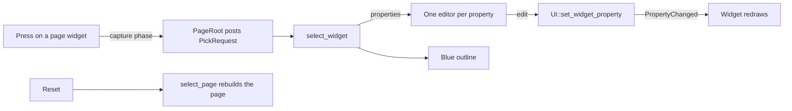
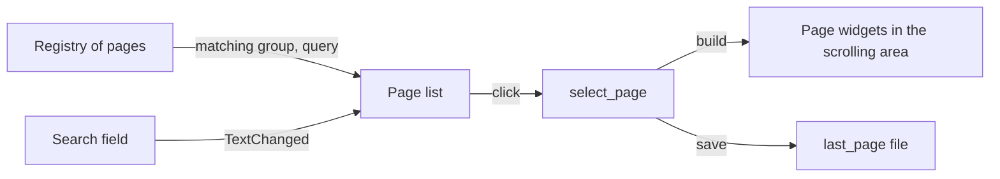
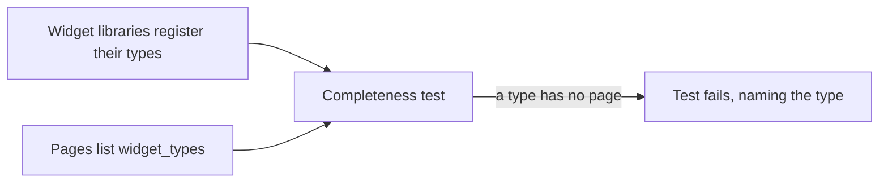

# The Pushrod Showcase

The showcase is one window that shows what Pushrod can do. The left side has a search field and the list of pages, grouped under **Core**, **Standard widgets**, **Layouts**, **Forms and resources**, and **Extra widgets**. The right side shows the selected page, with its title and a one-line description, inside a scrolling area.


Run it from the repository root:

```sh
cargo run -p pushrod-showcase
```

## Using it

- **Click a page** in the list to open it. The selected page stays pressed.
- **Type in the Search field** to filter the list. A page matches when what you typed (any case) appears in its name or its description. Groups with no match disappear; with no match at all, the list says **No pages match.**
- **Resize the window.** The list keeps its width and the page area takes the rest.
- **Close and reopen it.** The last page is remembered in `$XDG_CONFIG_HOME/pushrod-showcase/last_page` (or `~/.config/pushrod-showcase/last_page`).

## Changing a property live

Below the page is the **Properties** panel. It starts empty: *Click a widget on the page to select it.*


- **Click any widget on the page** to select it. A blue outline is drawn around it and the panel lists every property the widget reports through introspection (`Widget::properties`), so it works for any registered widget with no code for that widget.
- **Edit a property.** The editor depends on the kind of value:

| Kind | Editor |
| --- | --- |
| True or false (`enabled`, `hidden`) | A check box. |
| Whole or fractional number (`x`, `width`, `value`) | A text field. The widget changes as soon as the text is a valid number; half-typed text such as `-` is ignored until it is. |
| Text (`tooltip`) | A text field. |
| Color (`color`) | A text field holding `#rrggbb` or `#rrggbbaa`. |
| A choice (`align_horizontal`, `align_vertical`) | A button; each click shows the next of `start`, `center`, `end`, `fill`. |

- The line next to the title reports `Set <name>.` after an edit, or the error when the widget refuses the value (for example a width that is out of range).
- **Click Reset** to rebuild the page and clear the selection. Opening another page does the same.

Each edit goes through `Ui::set_widget_property`, so it emits a `PropertyChanged` engine event like any other property change. The panel is `pushrod-showcase/src/property_panel.rs`.



The page root (`PageRoot`) sees presses before the widget under the pointer, so a widget that consumes its own press, such as a slider, can still be selected.

## How it fits together



## Adding a page

A page is one small file in `pushrod-showcase/src/pages/` that implements the `Page` trait, plus one registration line.

```rust
use pushrod::geometry::size;
use pushrod::widget::WidgetId;
use pushrod_showcase::page::{Group, Page};
use pushrod_showcase::shell::ShowcaseUi;
use pushrod_widgets::button::Button;
use pushrod_widgets::panel::Panel;

pub struct HelloPage;

impl Page for HelloPage {
    fn name(&self) -> &'static str {
        "Hello"
    }

    fn group(&self) -> Group {
        Group::Standard
    }

    fn description(&self) -> &'static str {
        "A single button."
    }

    fn build(&self, ui: &mut ShowcaseUi<'_>) -> WidgetId {
        let root = ui.widgets().add(Box::new(Panel::new().size(520, 80)));

        ui.widgets()
            .add_child(root, Box::new(Button::new("Hello").at(10, 10).size(120, 24)));
        root
    }
}
```

Then, in `pages/mod.rs`, add `mod hello;` and, in `register_all`:

```rust
registry.register(hello::HelloPage);
```

| Method | Purpose |
| --- | --- |
| `name` | The button label in the list, and the key the last page is remembered by. Names must be unique; registering a duplicate panics. |
| `group` | The heading the page is listed under. |
| `description` | The line under the title. Search matches it too. |
| `build` | Adds the page's widgets and returns the root. Give the root a fixed size so the area knows how far to scroll. |
| `source` | The page's source code, for the source view. Return `include_str!("hello.rs")`; the default is an empty string. |

## Every widget has a page

A page lists the registered widget types it demonstrates in `widget_types`, for example `&["pushrod.slider"]`. The completeness test (`pushrod-showcase/tests/completeness.rs`) registers every widget library, then fails and names any type that no page lists:



**A pull request that adds a widget adds its page**, and adds its library's `register` call to the test when the library is new. The Standard widgets group has a page for every `pushrod.` type: Text, Button, Check Box, Radio Button, Slider, Glyph Button, Progress Bar, Separator, Group Box, Boxed Label, Frame, Image, Panel, and Text Field. Each page shows the widget's states and options live (normal, selected, disabled, sizes). The Image page uses a file that does not exist, so it shows the crossed box drawn for a missing file.

All sample data on the pages is fictional.
