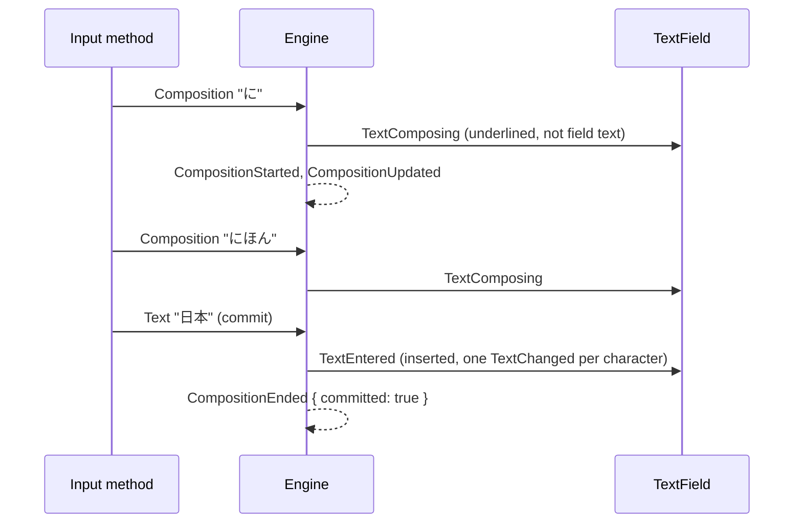

# Text Input and IME

Many languages are typed through an **input method** (IME). Typing "nihon" produces the composition
`にほん`, shown underlined until the user picks a candidate such as `日本` and commits it. The
operating system shows a **candidate window** next to the caret. Pushrod handles both, so
`TextField` works for these languages without any code in your application.

## What the user sees

- The composition text appears **inline at the caret**, underlined. The input method's own cursor
  is drawn inside it, and the part the input method has selected gets a thicker underline.
- Each update **replaces** the composition. Nothing is added to the field yet.
- When the user commits, the final text is **inserted** (replacing any selection), like typed text,
  and the underline disappears.
- The candidate window appears **beside the caret** and follows it as the text scrolls.
- A **password** field never shows what is being composed.
- Moving the focus away cancels the composition.



## Events

| Event | Sent to | When |
|---|---|---|
| `Event::TextComposing { id, text, cursor }` | The focused widget | The composition changed. `cursor` is the input method's `(start, length)` inside `text`, in characters. Empty `text` means it ended. |
| `Event::TextEntered { id, text }` | The focused widget | Text was typed, or the composition was committed. |
| `EngineEvent::CompositionStarted { id }` | `on_engine_event` | The first non-empty composition text for widget `id`. |
| `EngineEvent::CompositionUpdated { id, text, cursor }` | `on_engine_event` | Each change of the composition text. |
| `EngineEvent::CompositionEnded { id, committed }` | `on_engine_event` | `true` when the final text arrived as `TextEntered`; `false` when the composition was cancelled. |

All of them belong to the `TEXT` class of [event masks](../concepts/event-masks-for-the-run-loop-and-for-widgets.md),
except the engine events, which follow the rules in [Engine events](../events/engine-events.md).
`TextChanged` is sent **only when the composition is committed**, never while composing.

A cancelled composition is reported when the next event arrives: platforms clear the composition
text just before they send the committed text, so the engine waits for what follows before it says
whether the composition was committed.

## Watching a composition

```rust checked title="src/lib.rs"
use pushrod::engine::Engine;
use pushrod::event::{EngineEvent, EngineEventKind};
use pushrod::geometry::size;
use pushrod_widgets::text_field::TextField;

/// An engine that records every composition event in its state.
pub fn composition_log() -> Engine<Vec<String>> {
    let mut engine: Engine<Vec<String>> = Engine::new(size(300, 80), 30);

    engine.add_widget(TextField::new().at(20, 20).size(200, 24).with_label("Name:"));
    engine.on_engine_event_filtered(
        &[
            EngineEventKind::CompositionStarted,
            EngineEventKind::CompositionUpdated,
            EngineEventKind::CompositionEnded,
        ],
        |log, _ui, event| match event {
            EngineEvent::CompositionUpdated { text, .. } => log.push(format!("composing {text}")),
            EngineEvent::CompositionEnded { committed, .. } => log.push(format!("ended {committed}")),
            _ => {}
        },
    );
    engine
}
```

## Making your own text widget work with an IME

A widget that edits text needs three things:

1. **Return `true` from `Widget::accepts_text_input`**, so the engine starts text input while the
   widget has the focus.
2. **Handle `Event::TextComposing`**: keep the composition in its own field, separate from the
   text, draw it underlined at the caret, and return `Propagation::Stop`. Clear it on
   `Event::TextEntered` and on `Event::FocusLost`.
3. **Override `Widget::text_input_rect`** to return the caret rectangle (in the widget's own
   coordinates, as of the latest paint). The engine converts it to window coordinates and gives it
   to the backend with `Backend::set_text_input_rect`, once after each paint in which it moved.

`TextField` is the reference implementation (`pushrod-widgets/src/text_field.rs`).

## Backends

`pushrod-sdl2` turns SDL's text-editing events into `InputEvent::Composition`, sets SDL's text-input
rectangle from `set_text_input_rect`, and sets the `SDL_IME_SHOW_UI` hint so the platform draws its
own candidate window. Another backend sends `InputEvent::Composition { text, start, length }` and
implements `Backend::set_text_input_rect`; the default ignores it.

## Try it

Run the widget gallery and type in the **Name** field of the **Text Field** tile with an input
method switched on (for example Japanese Hiragana on macOS):

```bash
cargo run -p pushrod-sdl2 --example gallery
```

Type `nihon`: `にほん` appears underlined at the caret. Press Space to see candidates, Return to
commit. The field's text changes only at the commit.
