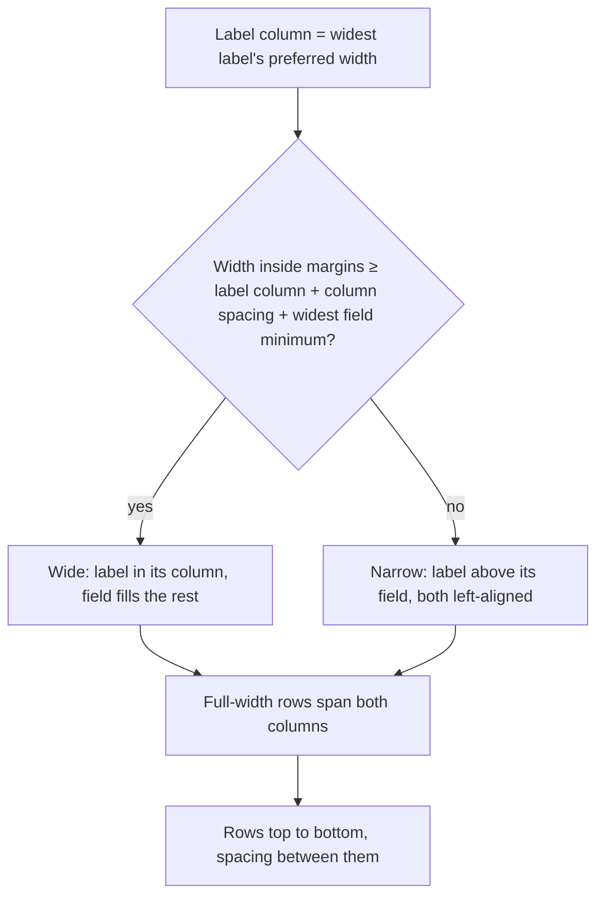

# Form Layout

`FormLayout` in `pushrod::layout` places a container's children as **"Label: field" rows**, the shape of most data-entry forms. Labels sit in a column as wide as the widest label, so the fields line up however long the translated text or however large the font. Fields fill the rest of the width.


## Building a form

Labels and fields are ordinary children of the container. Build the layout, add the rows, then give it to the container with `set_layout`:

| Call | Effect |
|---|---|
| `FormLayout::new()` | An empty form: no spacing, no margins, right-aligned labels. |
| `.spacing(px)` | Pixels between rows. |
| `.column_spacing(px)` | Pixels between the label column and the fields. |
| `.margins(Margin)` | Space kept inside the container's edges, such as `Margin::all(12)`. |
| `.label_align(Align)` | `Align::End` (the default) right-aligns labels next to their fields, the Mac style; `Align::Start` left-aligns them. |
| `form.add_row(label, field)` | A row with a label in the label column and a field that fills the rest. |
| `form.add_full_row(id)` | A row that spans both columns, such as a check box or a group box. |
| `form.field_for(label)` | The field a label names. |

`add_row` and `add_full_row` take `&mut self` and can be chained, so rows can be added in a loop.

## How rows are placed



- **Labels align to the widest label.** Each label is placed in the label column by `label_align`, and centered on its field's height.
- **Fields stretch.** A field fills the width after the label column, up to its maximum, and is never narrower than its minimum. A field's own vertical alignment is kept.
- **Narrow forms stack.** When the container is too narrow for the label column and the widest field's minimum, every label moves above its field and both fill the form's width from the left.
- **Full-width rows** fill the width up to their maximum.
- **Hidden children** are skipped: a row whose label is hidden keeps its field in the field column, and a row with both hidden takes no space.
- **Children in no row** are placed after the rows as full-width rows, in child order. A child added to more than one row is placed by its first row.

The form measures its **minimum** width as the narrow form (the widest label, field, or full-width row) and its **preferred** width as the wide form. Its heights are for the arrangement the container's current width gives.

## Clicking a label

Clicking a label gives the keyboard focus to its field. The cache asks the clicked child's container through `Layout::focus_target(child)`; `FormLayout` answers with the label's field. If the field cannot take focus (disabled or hidden), the focus stays where it is. A layout written by an application can answer `focus_target` the same way.

## Example

A settings form with right-aligned labels and a full-width check box:

```rust checked
use pushrod::backend::headless::HeadlessBackend;
use pushrod::cache::WidgetCache;
use pushrod::geometry::{point, size};
use pushrod::layout::{FormLayout, Margin};
use pushrod::root_widget::RootWidget;

fn main() {
    let mut cache = WidgetCache::new();

    cache.add(Box::new(RootWidget::new(size(300, 120))));

    let name_label = cache.add_child(0, Box::new(RootWidget::new(size(40, 16))));
    let name = cache.add_child(0, Box::new(RootWidget::new(size(100, 24))));
    let server_label = cache.add_child(0, Box::new(RootWidget::new(size(100, 16))));
    let server = cache.add_child(0, Box::new(RootWidget::new(size(100, 24))));
    let remember = cache.add_child(0, Box::new(RootWidget::new(size(120, 20))));
    let mut form = FormLayout::new()
        .spacing(6)
        .column_spacing(8)
        .margins(Margin::all(10));

    form.add_row(name_label, name)
        .add_row(server_label, server)
        .add_full_row(remember);
    cache.get_mut(0).unwrap().set_layout(Box::new(form));

    // Layout runs before the next frame is painted.
    cache.draw_loop(&mut HeadlessBackend::new(size(300, 120)));

    // "Name" is right-aligned in the 100 pixel label column and centered on its field.
    assert_eq!(cache.get(name_label).unwrap().get_origin(), point(70, 14));
    assert_eq!(cache.get(name).unwrap().get_origin(), point(118, 10));
    assert_eq!(cache.get(server).unwrap().get_size(), size(172, 24));
    assert_eq!(cache.get(remember).unwrap().get_size(), size(280, 20));
}
```

`cargo run -p pushrod-sdl2 --example form_layout` shows a settings form built this way. **Wider** and **Narrower** resize it: wide, the fields stretch; narrow, the labels move above their fields. **Left labels** and **Right labels** switch the label alignment, **click a label** to focus its field, and the status line shows each `LayoutChanged` and `FocusChanged` event. The widget gallery has a **Form Layout** tile.

## Engine event

`LayoutChanged { container }` is emitted each time the form arranges its rows. A label click that moves the focus emits `FocusChanged`. See [Engine events](../events/engine-events.md) and [Layouts Overview](./layouts-overview.md).
