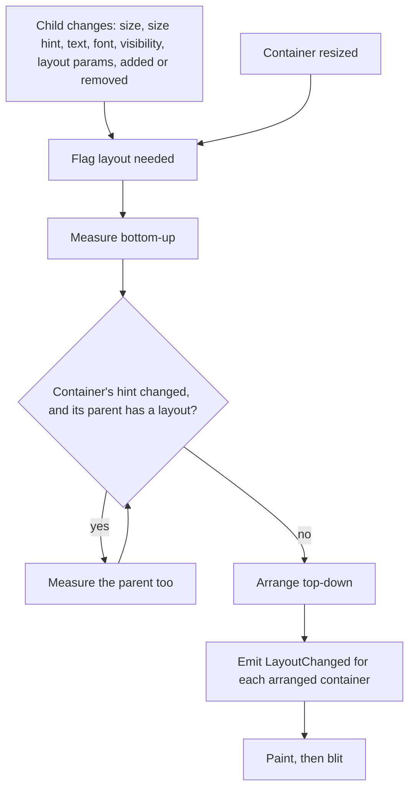

# Layouts Overview

By default a container is **absolutely positioned**: every child keeps the origin and size the application gave it. A **layout manager** replaces that for one container. Give a container a layout and it places its children from their **size hints**, so forms adapt to a resized window, translated text, and larger fonts.

Layouts are optional and extensible. A container without a layout behaves exactly as before, and an application can write its own manager by implementing one small trait. Ready-made layouts are built on this foundation:

| Layout | Use it for |
|---|---|
| [Row and Column](./row-and-column.md) | Children in a line, with spacing, margins, alignment, stretch, and `Spacer`: a column of fields, a row of buttons. |

## The pieces

| Type | What it is |
|---|---|
| `SizeHint { min, preferred, max }` | What a widget reports: the smallest, wanted, and largest size. `UNBOUNDED` as a maximum means no limit. |
| `LayoutParams { stretch, alignment, margin }` | What a child asks of its container: its share of extra space, how it sits in its slot (`Alignment` of `Align::Start`, `Center`, `End`, `Fill`), and the space around it (`Margin`). |
| `ChildInfo { id, hint, params }` | What a layout is told about each visible child. |
| `trait Layout` | `measure(children, available) -> SizeHint` and `arrange(children, bounds) -> Vec<Rect>`. |

`place_in_slot(slot, child)` applies a child's margin and alignment to a slot, so managers treat them the same way.

## When layout runs

Layout is its own invalidation level, run **once per frame, before painting**, and only when something changed.



- **Invalidation stops early.** A change is measured up through containers only while each container's hint keeps changing. A container whose hint is unchanged is arranged, but its parent is not.
- **Moving is cheap.** A child that only moved is not repainted; its cached texture is copied to the new place. A child that was resized is repainted, and if it is a container, arranged in turn.
- **Once per frame.** Several changes in one frame cause one measure and one arrange per container.
- **Text measures itself.** `Text` reports its size from the text layout through the painter, so a label is as wide as its words.

## Giving a container a layout

Call `set_layout` on the container, and `set_layout_params` on a child to change its stretch, alignment, or margin. `remove_layout` returns the container to absolute positioning, and the children keep the places they have.

| Call | Effect |
|---|---|
| `widget.set_layout(Box::new(layout))` | The container places its children. |
| `widget.remove_layout()` | Back to absolute positioning. |
| `widget.set_layout_params(params)` | The child's stretch, alignment, and margin. |
| `widget.set_size_hint(hint)` | A fixed hint that replaces the widget's own. |
| `widget.request_layout()` | Ask for layout after changing something that affects the hint. Built-in setters do this for you. |
| `cache.invalidate_layout(id)` | The same, through the cache. |
| `cache.measured_hint(id)` | The hint a container's layout last measured; the root's minimum is the window's minimum size. |

A widget with no hint of its own reports the size the application gave it (`set_size`) as its minimum and preferred size, with no maximum. A layout changing a widget's size does not change that.

## Writing a layout

This layout stacks its children in a column:

```rust checked
use pushrod::cache::WidgetCache;
use pushrod::geometry::{Rect, Size, point, size};
use pushrod::layout::{ChildInfo, Layout, SizeHint};
use pushrod::root_widget::RootWidget;

#[derive(Debug)]
struct Stack;

impl Layout for Stack {
    fn measure(&self, children: &[ChildInfo], _available: Size) -> SizeHint {
        let w = children.iter().map(|c| c.hint.preferred.w).max().unwrap_or(0);
        let h = children.iter().map(|c| c.hint.preferred.h).sum();

        SizeHint::fixed(size(w, h))
    }

    fn arrange(&self, children: &[ChildInfo], bounds: Rect) -> Vec<Rect> {
        let mut y = bounds.y;

        children
            .iter()
            .map(|c| {
                let r = Rect::new(bounds.x, y, c.hint.preferred.w, c.hint.preferred.h);

                y += c.hint.preferred.h as i32;
                r
            })
            .collect()
    }
}

fn main() {
    let mut cache = WidgetCache::new();

    cache.add(Box::new(RootWidget::new(size(100, 100))));

    let first = cache.add_child(0, Box::new(RootWidget::new(size(40, 10))));
    let second = cache.add_child(0, Box::new(RootWidget::new(size(40, 20))));

    cache.get_mut(0).unwrap().set_layout(Box::new(Stack));

    // The next frame measures and arranges; `draw_loop` does it before painting.
    let mut backend = pushrod::backend::headless::HeadlessBackend::new(size(100, 100));

    cache.draw_loop(&mut backend);

    assert_eq!(cache.get(first).unwrap().get_origin(), point(0, 0));
    assert_eq!(cache.get(second).unwrap().get_origin(), point(0, 10));
}
```

Rules for a layout:

- It receives **visible children only**, and must return **one rectangle per child**, in the same order, relative to the container's upper left-hand corner. A missing rectangle leaves its child where it is.
- It must be a **pure function** of its arguments, since layout can run any number of times.
- It never paints; the engine repaints only the widgets whose size changed.

## Engine event

`LayoutChanged { container }` is emitted after a container's children were arranged. See [Engine events](../events/engine-events.md).

## Example

`cargo run -p pushrod-sdl2 --example custom_layout` shows a wrapping `Flow` layout written by the application: **Add label** adds a label, **Hide/show first** moves the others without repainting them, and **Longer text** resizes the first label.
