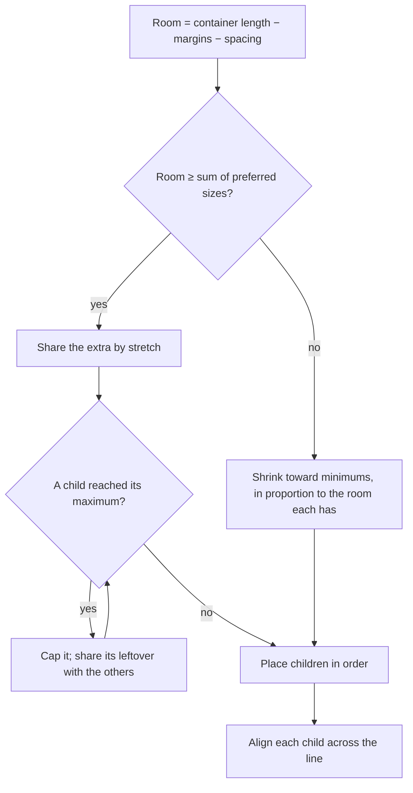

# Row and Column

`Row` and `Column` in `pushrod::layout` place a container's children in a line: a `Row` left to right, a `Column` top to bottom. Most dialogs are built from them: a column of fields above a row of buttons, with a `Spacer` pushing OK and Cancel to the right.


## Building a layout

Each layout is built with chained calls, then given to a container with `set_layout`:

| Call | Effect |
|---|---|
| `Row::new()`, `Column::new()` | No spacing, no margins, and each child's own alignment. |
| `.spacing(px)` | Pixels between neighboring children. |
| `.margins(Margin)` | Space kept inside the container's edges, such as `Margin::all(12)`. |
| `.align(Align)` | Places every child across the line (vertically in a row, horizontally in a column) with `Align::Start`, `Center`, `End`, or `Fill`, in place of each child's own alignment. |

Without `.align`, each child is placed across the line by its own `LayoutParams::alignment`. A child's `LayoutParams::margin` is kept around it as well.

## Sharing space

Along the line, every child starts at its **preferred** size.

- **Extra space** goes to children whose `LayoutParams::stretch` is above zero, in proportion to it: a child with stretch `2` gets twice the extra of a child with stretch `1`. Children with stretch `0` keep their preferred size.
- A child never grows past its **maximum**. The space it cannot take is shared by the other stretching children.
- **Too little space** shrinks children toward their **minimum**, each in proportion to how far it can shrink. When every child is at its minimum, the children run past the container's edge rather than being made smaller.
- Across the line, a child is never placed in less than its minimum.



The container measures as the sum of its children along the line (with spacing and margins), and the largest child across it. A row or column inside another one therefore reports the right size to its parent.

## Spacer

`Spacer::stretch()` is an empty, invisible widget with no size and a stretch of `1`. It takes the extra space in its row or column, which pushes the children after it to the right or bottom. Two spacers around a child center it.

## Example

A column of fields above a row of buttons; the row's spacer right-aligns OK and Cancel, and the column's spacer keeps the row at the bottom:

```rust checked
use pushrod::backend::headless::HeadlessBackend;
use pushrod::cache::WidgetCache;
use pushrod::geometry::{point, size};
use pushrod::layout::{Align, Alignment, Column, LayoutParams, Margin, Row, Spacer};
use pushrod::root_widget::RootWidget;

fn main() {
    let mut cache = WidgetCache::new();

    cache.add(Box::new(RootWidget::new(size(300, 200))));

    let fill = LayoutParams {
        alignment: Alignment::new(Align::Fill, Align::Start),
        ..LayoutParams::default()
    };
    let name = cache.add_child(0, Box::new(RootWidget::new(size(100, 24))));

    cache.get_mut(name).unwrap().set_layout_params(fill);
    cache.add_child(0, Box::new(Spacer::stretch()));

    let buttons = cache.add_child(0, Box::new(RootWidget::new(size(0, 0))));

    cache.add_child(buttons, Box::new(Spacer::stretch()));

    let ok = cache.add_child(buttons, Box::new(RootWidget::new(size(80, 24))));
    let cancel = cache.add_child(buttons, Box::new(RootWidget::new(size(80, 24))));

    cache.get_mut(buttons).unwrap().set_layout_params(fill);
    cache
        .get_mut(buttons)
        .unwrap()
        .set_layout(Box::new(Row::new().spacing(8)));
    cache
        .get_mut(0)
        .unwrap()
        .set_layout(Box::new(Column::new().spacing(6).margins(Margin::all(10))));

    // Layout runs before the next frame is painted.
    cache.draw_loop(&mut HeadlessBackend::new(size(300, 200)));

    assert_eq!(cache.get(name).unwrap().get_size(), size(280, 24));
    assert_eq!(cache.get(buttons).unwrap().get_origin(), point(10, 166));
    assert_eq!(cache.get(ok).unwrap().get_origin(), point(112, 0));
    assert_eq!(cache.get(cancel).unwrap().get_origin(), point(200, 0));
}
```

`cargo run -p pushrod-sdl2 --example row_and_column` shows a dialog built this way. **Wider** and **Narrower** resize it: the fields stretch, the **Notes** field stops at its maximum width, OK and Cancel stay at the right, and the status line shows each `LayoutChanged` event. The widget gallery has a **Row and Column** tile.

## Engine event

`LayoutChanged { container }` is emitted each time a row or column arranges its children. See [Engine events](../events/engine-events.md) and [Layouts Overview](./layouts-overview.md).
