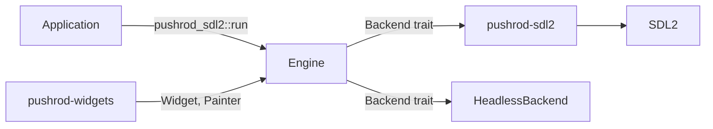

# Backends

A **backend** is everything between Pushrod and a screen: the window, input, one texture per widget, the clock, the clipboard, and opening URLs. The core (`pushrod`) and the widget library (`pushrod-widgets`) contain no SDL code; they talk to a `Backend`, so a widget library works on any backend and moving to another windowing library (SDL3, a retro machine) does not touch it.



| Crate | Depends on SDL2 | Provides |
|---|---|---|
| `pushrod` | No | `Backend` and `Painter` traits, `Color`, `Point`/`Size`/`Rect`, `Key`/`Modifiers`/`MouseButton`, `InputEvent`, `HeadlessBackend` |
| `pushrod-widgets` | No | The standard widgets |
| `pushrod-sdl2` | Yes | `Sdl2Backend`, `Sdl2Painter`, `WindowSettings`, `run`, `event_loop`; the `bundled` and `static-link` features |

Run `cargo tree -p pushrod` or `cargo tree -p pushrod-widgets`: neither lists `sdl2`.

## Choosing a backend

Add the backend crate to your application and start the loop through it:

```rust
use pushrod::engine::Engine;
use pushrod::geometry::size;
use pushrod_sdl2::{WindowSettings, run};

fn main() -> Result<(), pushrod::error::Error> {
    let engine: Engine<u32> = Engine::new(size(400, 300), 60);

    // Opens the window, runs until it closes, and returns the state.
    let clicks = run(engine, WindowSettings::new("My app", size(400, 300)), 0)?;

    println!("{clicks}");

    Ok(())
}
```

`WindowSettings` has a `title`, a `size`, `centered` (default `true`) and `resizable` (default `false`). For your own event loop, use `pushrod_sdl2::event_loop(&mut engine, settings)` and `engine.next_event(&mut events)`; see [Handling events](../guides/handling-events.md).

## The `Backend` trait

| Method | Does |
|---|---|
| `cache_policy()` | How painted widgets are kept; the SDL2 backend uses `TextureCache`. |
| `window_size()`, `resize_window(size)` | Reads and changes the window size. The window is created when the backend is built. |
| `set_event_mask(mask)` | Tells the backend which input classes the application wants. |
| `set_text_input(active)` | Starts or stops text input while a text editor has focus. |
| `poll_events(wait)` | Returns waiting `InputEvent`s, optionally blocking for the first one. |
| `waker()` | A function other threads call to wake the loop. |
| `now()` | The clock. |
| `paint_widget(id, size, paint)` | Paints one widget into its own texture, only when it was invalidated. |
| `begin_frame(color)`, `draw_widget(id, bounds)`, `present()` | Composes a frame by blitting cached textures. |
| `take_notices()` | Engine events the backend produced (fonts loaded, atlas pages added). |
| `clipboard_text()`, `set_clipboard_text(text)` | The clipboard. |
| `open_url(url)` | Opens a URL in the default handler. |

## Input types

Input uses Pushrod's own types, so no SDL type appears in a public signature of the core or the widgets:

| Type | Values |
|---|---|
| `Key` | `Char('a')` (printable keys, lowercase), `Tab`, `Return`, `KpEnter`, `Escape`, `Backspace`, `Delete`, `Home`, `End`, `PageUp`, `PageDown`, `Up`, `Down`, `Left`, `Right`, `F(n)`, `Other(code)` |
| `Modifiers` | `SHIFT`, `CTRL`, `ALT`, `GUI` (left and right keys are not distinguished) |
| `MouseButton` | `Left`, `Middle`, `Right`, `Other(n)` |

The backend converts what the windowing library reports into an `InputEvent` (`MouseDown`, `MouseUp`, `MouseMove`, `Wheel`, `KeyDown`, `KeyUp`, `Text`, `Resized`, `FocusChanged`, `Exposed`, `Quit`, `Wake`).

## Testing without a display

`HeadlessBackend` has no window. Queue input with `push_event`, run the engine, then read what it recorded:

```rust
use pushrod::backend::headless::HeadlessBackend;
use pushrod::engine::Engine;
use pushrod::geometry::{point, size};
use pushrod::input::{InputEvent, MouseButton};

let mut engine: Engine<u32> = Engine::new(size(100, 100), 30);
let mut backend = HeadlessBackend::new(size(100, 100));

backend.push_event(InputEvent::MouseDown {
    position: point(5, 5),
    button: MouseButton::Left,
    clicks: 1,
});

// The loop ends when the script is empty.
engine.run(&mut backend, 0);

assert!(backend.frames > 0);
```

`backend.painted` lists every widget paint and its `PaintCall`s, `backend.draws` the textures composed into each frame, and `backend.frames` the frames presented. To dispatch one event without a loop, call `engine.dispatch(event, &mut state)`.

## Rendering rules

The SDL2 backend keeps today's design: one GPU texture per widget, repainted only when the widget is invalidated, frames composed by blitting, and text from the glyph atlas (see [GPU text](../concepts/gpu-text.md)). Pushrod never uses OS-native menus, dialogs, or controls.
