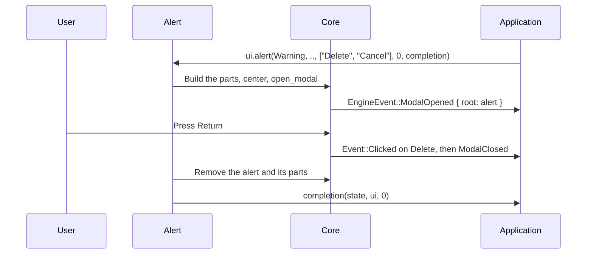

# Alert

`Alert` (module `pushrod_widgets::alert`): a modal alert with an icon, a title, a message, and a row of buttons. Open one from any callback with one call, `ui.alert(..)`. It is centered in the window and takes all the input until a button is chosen. Then it closes, is removed from the window, and a completion closure gets the chosen button's index.

It is a [composite widget](../guides/composite-widgets.md) opened as a [modal dialog](../forms/modal-dialogs.md). Its icon, title, message, and buttons are ordinary widgets with their own IDs, and an application can find and restyle each one.


## Creating it

`ui.alert` comes from the `AlertExt` trait, which is in `pushrod_widgets::prelude`.

```rust checked title="src/delete.rs"
use pushrod::engine::Engine;
use pushrod::geometry::size;
use pushrod_widgets::alert::{AlertExt, AlertKind};
use pushrod_widgets::button::Button;

/// The application state: whether the fictional report was deleted.
#[derive(Default)]
pub struct Files {
    pub report_deleted: bool,
}

/// A Delete... button that asks before deleting.
pub fn build() -> Engine<Files> {
    let mut engine: Engine<Files> = Engine::new(size(480, 320), 30);
    let delete = engine.add_widget(Button::new("Delete...").at(20, 20).size(120, 24));

    engine.on_click(delete, |_files, ui| {
        // Return chooses Delete (index 0, the default); Escape chooses Cancel (the last).
        ui.alert(
            AlertKind::Warning,
            "Delete \"report.txt\"?",
            "This cannot be undone.",
            &["Delete", "Cancel"],
            0,
            |files, _ui, choice| {
                if choice == 0 {
                    files.report_deleted = true;
                }
            },
        );
    });
    engine
}
```

| Argument | Type | Meaning |
|---|---|---|
| `kind` | `AlertKind` | Picks the icon: `Info` (white `i` on blue), `Warning` (black `!` on yellow), `Error` (white `×` on red), or `Question` (white `?` on dark blue). |
| `title` | `&str` | The first line, in a larger font. |
| `message` | `&str` | The text under the title. It wraps at spaces onto two lines. |
| `buttons` | `&[&str]` | The button labels, left to right. An empty list gets one `OK` button. |
| `default` | `usize` | The index of the button Return chooses. An index past the end means the last button. |
| `completion` | `FnOnce(&mut S, &mut Ui, usize)` | Runs once, with the application state, a `Ui`, and the chosen button's index. |

`ui.alert` returns an `AlertHandle`, used to reach and change the parts while the alert is open.

## Choosing a button

| Input | Chooses |
|---|---|
| **Return** | The default button, drawn with a heavier border. |
| **Escape** (or Cmd-. on macOS) | The last of the buttons given to `ui.alert`. |
| **Click** | That button. |

While the alert is open nothing else in the window receives input: clicks, keys, hover, and focus stay inside it, and the main window's default button is never pressed. The rest of the window is still drawn, darkened and blurred.



## Methods

`AlertHandle`, returned by `ui.alert`:

| Method | Does |
|---|---|
| `id()` | The alert's widget ID. |
| `parts()` | The parts, as an `AlertParts`, as of the last change made through this handle. |
| `add_button(ui, label)` | Adds a button with the next index, placed at the lower left. It closes the alert like the others. Returns its ID, or `None` once the alert has closed. |
| `remove_button(ui, index)` | Removes a button. The buttons after it move down one index. Returns `false` if there is no such button, it is the only one, or the alert has closed. |
| `set_default_button(ui, index)` | Makes a button the one Return chooses. Returns `false` if there is no such button or the alert has closed. |

The same three changes are associated functions on `Alert` that take a `WidgetCache` and return a `Result`: `Alert::add_button(cache, alert, label)`, `Alert::remove_button(cache, alert, index)`, and `Alert::set_default_button(cache, alert, index)`. `Alert::new(kind, title, message, buttons, default)` creates the widget without opening it, and `button_index(id)` turns a button's ID into its index.

## Parts

| Name | Field of `AlertParts` | Widget | Default look |
|---|---|---|---|
| `"icon"` | `icon` | `BoxedLabel` | 32 by 32, the kind's symbol and colors, a black border |
| `"title"` | `title` | `Text` | Black, 16 points |
| `"message"` | `message` | `Text`, wrapping at spaces | Dark gray, 14 points |
| `"button:0"`, `"button:1"`, ... | `buttons` | `Button` | 84 by 24; the default one has a heavier border |

Change a part like any other widget: find it, then use the normal API. This alert has a bold red message and an extra **Help** button:

```rust checked title="src/customized.rs"
use pushrod::color::{Color, FontStyle};
use pushrod::engine::Ui;
use pushrod::font::Font;
use pushrod_widgets::alert::{AlertExt, AlertKind};
use pushrod_widgets::text::Text;

/// Opens the delete warning with a bold red message and a Help button (index 2).
pub fn open_customized(ui: &mut Ui<()>) {
    let mut alert = ui.alert(
        AlertKind::Warning,
        "Delete \"report.txt\"?",
        "This cannot be undone.",
        &["Delete", "Cancel"],
        0,
        |_state, _ui, choice| {
            if choice == 2 {
                // Show help.
            }
        },
    );

    if let Some(message) = ui.get_mut::<Text>(alert.parts().message) {
        message.set_font_color(Color::RED);
        message.set_font(Font::new("", 14, FontStyle::BOLD));
    }

    alert.add_button(ui, "Help");
}
```


## Layout

```text
 +-----------------------------------------------+
 |  [!]  Title                                   |
 |       Message, wrapped onto two lines.        |
 |                                               |
 |  [Help]              [[Delete]]   [Cancel]    |
 +-----------------------------------------------+
   added buttons         buttons given to alert
```

- The alert is 360 by 140 pixels (`MIN_WIDTH` by `HEIGHT`), and wider when its buttons need the room. It is centered in the window, and centered again each time a button is added or removed.
- The buttons given to `ui.alert` are right-aligned at the bottom, in order. Buttons added with `add_button` go at the lower left.
- The alert lays its parts out again whenever a button is added or removed, so a part's position and size are set by the alert. Change their look, text, and font instead.

## Common methods

Every widget also has the methods of the `Widget` trait: `get_id`, `get_parent`, `get_origin`/`set_origin`, `get_size`/`set_size`, `get_color`/`set_color`, `is_hidden`/`set_hidden`, `is_enabled`/`set_enabled`, and `is_invalidated`/`set_invalidated`. See [Creating widgets](../guides/creating-widgets.md).

## Events and callbacks

| Event | Emitted when | Callback |
|---|---|---|
| (completion) | A button is chosen. | The completion closure given to `ui.alert`, with the button's index |
| `Event::Clicked { id, .. }` (on a button part's ID) | A button is clicked, or chosen with Return or Escape. It runs before the completion closure. | `engine.on_click(part_id, ..)` |
| `Engine(WidgetAdded { .. })`, `Engine(PartsArranged { .. })` | The alert and its parts were built, or a button was added or removed. | `engine.on_engine_event(..)` |
| `Engine(ModalOpened { root })` | The alert opened. | `engine.on_engine_event(..)` |
| `Engine(DialogDismissRequested { id })`, `Engine(ModalClosed { root, dismissed_by })` | A button closed the alert. | `engine.on_engine_event(..)` |
| `Engine(WidgetRemoved { .. })` | The alert and its parts were removed after closing. | `engine.on_engine_event(..)` |

## Notes

- Each call builds a new alert and removes it when it closes, so the handle and part IDs stop working after that: `get` returns `None` and the handle's methods return `None` or `false`.
- Escape belongs to the last button given to `ui.alert`, not to a button added later. If that button is removed, Escape moves to the last remaining one.
- If the default button is removed, Return does nothing until `set_default_button` is called.
- An alert always keeps at least one button, so it can always be closed.
- Alerts nest: a callback, including a completion closure, can open another alert or dialog over this one.
- The handle keeps its own copy of the parts. A handle moved into a callback can fall behind changes made elsewhere; read the current parts with `ui.get::<Alert>(handle.id())` and `typed_parts()`.
- Buttons have a fixed width; a long label is shortened with an ellipsis.

The complete program, with a quit confirmation, is `pushrod-sdl2/examples/alert.rs`. Run it with `cargo run -p pushrod-sdl2 --example alert`.

## Planned

A task dialog with expandable details and a "don't ask again" box is an [extra widget](../extra-widgets/index.md). Changing the alert's look by theme is the distant [theming epic](https://github.com/KenSuenobu/rust-pushrod/blob/main/docs/ROADMAP_EXTENSIBLE_WIDGET_LIBRARY.md).
