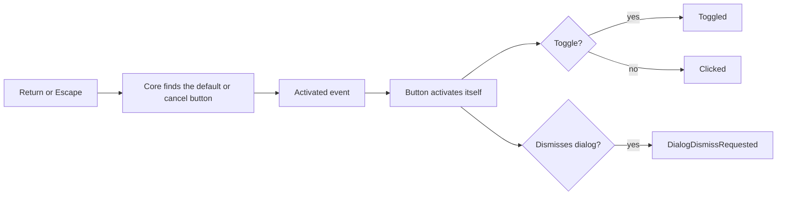

# Button

`Button` (module `pushrod_widgets::button`): a push button with a text label that emits `Clicked`.


## Creating it

```rust
use pushrod::prelude::*;
use pushrod_widgets::prelude::*;

let button = engine.add_widget(
    Button::new("Click me")
        .at(20, 70)
        .size(120, 30)
        .font(Font::default().with_size(16)),
);

engine.on_click(button, |state, ui| {
    // runs on every click
});
```

| Setter | Type | Default | Meaning |
|---|---|---|---|
| `Button::new(label)` | `impl Into<String>` | required | The label. |
| `at(x, y)` | `i32`, `i32` | `0, 0` | Upper-left corner, relative to the parent. |
| `size(width, height)` | `u32`, `u32` | `100, 24` | Width and height in pixels. |
| `font(font)` | `Font` | `Font::default()` | A [font handle](../concepts/text-and-fonts.md): family, size, and style. |
| `font_color(color)` | `Color` | black | Label color. |
| `justify(justification)` | `TextJustify` | `Center` | `Left`, `Center`, or `Right`. |
| `border_width(width)` | `u8` | `2` | Inset of the label from the edges, in pixels. |

## Behaviors

A button gets its other behaviors from the core's `Behavior` flags. Set them with these builders (or `Widget::set_behavior`); they combine.


| Builder | Flag | Look | Activated by | Emits |
|---|---|---|---|---|
| (none) | none | normal | release inside the button | `Clicked` |
| `default_action()` | `DEFAULT_ACTION` | 2 px border ring | also **Return** | `Clicked` |
| `cancel_action()` | `CANCEL_ACTION` | normal | also **Escape** (Cmd-. on macOS) | `Clicked` |
| `toggle()` | `TOGGLE` | inverted while checked | each activation flips it | `Toggled { id, checked }`, not `Clicked` |
| `activate_on_press()` | `ACTIVATE_ON_PRESS` | normal | the press, not the release | as above |
| `dismisses_dialog()` | `DISMISSES_DIALOG` | normal | as above | also `EngineEvent::DialogDismissRequested { id }` |

```rust checked title="src/dialog.rs"
use pushrod_widgets::button::Button;

/// A fictional dialog's buttons: OK is the default and closes the dialog, Cancel answers
/// Escape and closes it, and Bold is a toggle.
pub fn dialog_buttons() -> (Button, Button, Button) {
    let ok = Button::new("OK").at(20, 60).size(80, 24).default_action().dismisses_dialog();
    let cancel = Button::new("Cancel").at(110, 60).size(80, 24).cancel_action().dismisses_dialog();
    let bold = Button::new("Bold").at(200, 60).size(80, 24).toggle();
    (ok, cancel, bold)
}
```

Return and Escape act on the form that holds the focus: the nearest enclosing widget that contains an enabled, visible default (or cancel) button. A disabled or hidden button is never activated by a key.



## Methods

| Method | Does |
|---|---|
| `set_text(text)` / `get_text()` | The label. |
| `set_border_width(width)` / `get_border_width()` | Label inset. |
| `is_selected()` | `true` while drawn pressed. |
| `is_checked()` / `set_checked(checked)` | A toggle's state; `set_checked` repaints but emits no event. |
| `set_color(color)` | Background color when not pressed. |

## Common methods

Every widget also has the methods of the `Widget` trait: `get_id`, `get_parent`, `get_origin`/`set_origin`, `get_size`/`set_size`, `get_color`/`set_color`, `is_hidden`/`set_hidden`, and `is_invalidated`/`set_invalidated`. See [Creating widgets](../guides/creating-widgets.md).

## Events and callbacks

| Event | Emitted when | Callback |
|---|---|---|
| `Event::Clicked { id, button, count }` | The left button is released over the button while it is still pressed; with `activate_on_press`, when it goes down; for a default or cancel button, also on Return or Escape. | `engine.on_click(id, ..)` |
| `Event::Toggled { id, checked }` | A toggle button is activated; `checked` is the new state. | `engine.on_toggle(id, ..)` |
| `EngineEvent::DialogDismissRequested { id }` | A `dismisses_dialog` button is activated. Inside an open [modal dialog](../forms/modal-dialogs.md) it closes the dialog, and the `open_modal` callback receives the button's ID. | `ui.open_modal(..)`, `engine.on_engine_event(..)` |

The application also still receives `Event::Activated { id }` when Return or Escape picks the button.

## Notes

Behavior: pressing the mouse button inverts the button (black background, white text). Dragging off it restores the normal look and dragging back inverts it again. The click only counts if the mouse button is released while the button is still inverted.

## Mnemonic

A `_` before a character in the label (`Button::new("_Save")`) underlines it, and Alt plus that letter clicks the button. See [Keyboard mnemonics](../concepts/keyboard-mnemonics.md).

## Planned

Per-state colors are planned; see the [roadmap](https://github.com/KenSuenobu/rust-pushrod/blob/main/docs/ROADMAP_EXTENSIBLE_WIDGET_LIBRARY.md).
