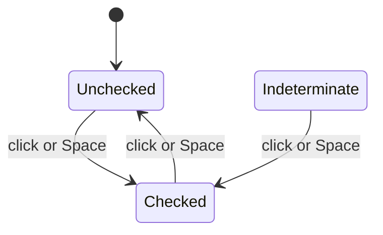

# Check Box

`CheckBox` (module `pushrod_widgets::check_box`): a square box followed by a label. The box is empty when unchecked, holds a check mark when checked, and holds a dash when it is *indeterminate* (a "mixed" state, for a box that summarizes several items).


## Creating it

```rust checked title="src/options.rs"
use pushrod_widgets::check_box::CheckBox;

/// A fictional options form: one checked box, and one that summarizes several items.
pub fn option_boxes() -> (CheckBox, CheckBox) {
    let send = CheckBox::new("Send email").at(20, 20).size(150, 20).checked(true);
    let all = CheckBox::new("All items").at(20, 50).size(150, 20).indeterminate();
    (send, all)
}
```

Listen for changes with `engine.on_toggle(id, |state, ui, checked| ..)`.

| Setter | Type | Default | Meaning |
|---|---|---|---|
| `CheckBox::new(label)` | `impl Into<String>` | required | The text after the box. |
| `at(x, y)` | `i32`, `i32` | `0, 0` | Upper left-hand corner, relative to the parent. |
| `size(w, h)` | `u32`, `u32` | `150, 20` | Width and height in pixels. |
| `font(font)` | `Font` | default font | The label's font. |
| `font_color(color)` | `Color` | black | The label's color. |
| `checked(bool)` | `bool` | `false` | Starts checked. |
| `indeterminate()` | none | off | Starts in the mixed state. |

## Methods

| Method | Does |
|---|---|
| `is_checked()` / `set_checked(bool)` | The checked state. `set_checked` clears the indeterminate state and emits no event. |
| `is_indeterminate()` / `set_indeterminate(bool)` | The mixed state. Entering it unchecks the box; no event is emitted. |
| `set_text(text)` / `get_text()` | The label. |
| `is_pressed()` | `true` while the mouse button is down on it. |
| `toggle(ctx)` | Toggles as a click would and emits `Toggled`. |

## Common methods

Every widget also has the methods of the `Widget` trait: `get_id`, `get_parent`, `get_origin`/`set_origin`, `get_size`/`set_size`, `get_color`/`set_color`, `is_hidden`/`set_hidden`, `is_enabled`/`set_enabled`, and `is_invalidated`/`set_invalidated`. See [Creating widgets](../guides/creating-widgets.md).

## Events and callbacks

| Event | Emitted when | Callback |
|---|---|---|
| `Event::Toggled { id, checked }` | The box or its label is clicked, or Space is pressed while it has focus; `checked` is the new state. | `engine.on_toggle(id, ..)` |
| `Event::FocusGained` / `FocusLost { id }` | Keyboard focus moves to or from it. | `engine.on_focus_change(id, ..)` |

## How it toggles



## Notes

- Clicking **anywhere** on the widget, label included, toggles it. The click only counts if the mouse button is released while still over the check box; dragging off cancels it.
- While the mouse button is held down the box is drawn inverted: a black fill, with the check mark (or the dash) shown in white. An unchecked box is solid black.
- Clicking or Tab-ing to it gives it keyboard focus; the focus outline and the dimmed look of a disabled widget are drawn by the core.
- An indeterminate box is never reported as checked. A click or Space on it makes it checked and emits `Toggled { checked: true }`.
- Only `CHECKED` is mirrored into the widget's `VisualState`. The core's `INDETERMINATE` overlay is a bar across the whole widget, which would strike through the label, so the dash is drawn inside the box by the widget.

## Mnemonic

A `_` before a character in the label (`CheckBox::new("_Remember me")`) underlines it, and Alt plus that letter toggles the box. See [Keyboard mnemonics](../concepts/keyboard-mnemonics.md).
