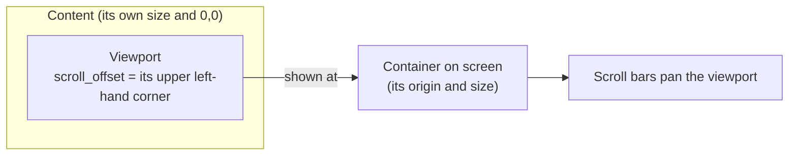
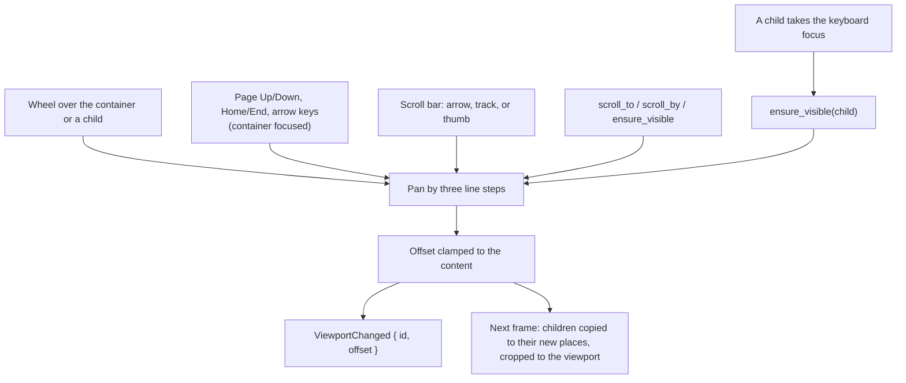

# Container

`Container` (module `pushrod_widgets::container`): a scrollable viewport onto a content area. The content has its own size and its own `0,0`, like a form. The container's frame is a window onto it. Scroll bars appear when the content does not fit.

It is a [composite widget](../guides/composite-widgets.md). Its content viewport, two scroll bars, and corner are ordinary widgets with their own IDs.




- **Resize the container** and more or less of the content is visible. The content keeps its size.
- **Move the container** and the viewport moves on screen. Nothing shifts inside the content.
- **Pan** and the content slides under the viewport. No child is repainted.

## Creating it

Give the container its origin, its size on screen, and the size of its content. Then add the children to its `content` part, at positions relative to the content's `0,0`.

```rust checked title="src/notes.rs"
use pushrod::engine::Engine;
use pushrod::geometry::{point, size};
use pushrod_widgets::container::Container;
use pushrod_widgets::text::Text;

/// A 300 by 200 viewport onto 300 by 1200 of content: forty lines of fictional notes.
pub fn notes() -> Engine<()> {
    let mut engine: Engine<()> = Engine::new(size(400, 300), 30);
    let container = engine.add_widget(Container::new(
        point(20, 20),
        size(300, 200),
        size(300, 1200),
    ));
    let content = engine
        .widgets()
        .get_as::<Container>(container)
        .map_or(container, |c| c.content());

    for line in 0..40 {
        // Positions are in content coordinates: line 39 is at y = 1170, far below the viewport.
        engine.add_child_widget(
            content,
            Text::new(format!("Note {}", line + 1))
                .at(10, line * 30)
                .size(200, 20),
        );
    }
    engine
}
```

Listen for panning with the engine:

```rust checked title="src/listen.rs"
use pushrod::engine::Engine;
use pushrod::geometry::{point, size};
use pushrod_widgets::container::Container;

/// The application state: the first content row on screen.
#[derive(Default)]
pub struct View {
    pub top: i32,
}

/// Records how far the container is scrolled.
pub fn listen() -> Engine<View> {
    let mut engine: Engine<View> = Engine::new(size(400, 300), 30);
    let id = engine.add_widget(Container::new(
        point(20, 20),
        size(300, 200),
        size(300, 1200),
    ));

    engine.on_viewport_change(id, |view, _ui, offset| view.top = offset.y);
    engine
}
```

| Setter | Type | Default | Meaning |
|---|---|---|---|
| `Container::new(origin, viewport_size, content_size)` | `Point`, `Size`, `Size` | required | The upper left-hand corner, the size on screen (including the scroll bars), and the size of the content. |
| `scroll_bars(policy)` | `ScrollBars` | `Auto` | `Auto` shows each bar only while the content is larger than the viewport in its direction. `Always` shows both. `Never` shows none; the wheel, keys, and code still pan. |
| `content_mode(mode)` | `ContentSize` | `Fixed` | How the content gets its size. See [Content size](#content-size). |
| `line_step(pixels)` | `u32` | `20` | How far an arrow key or a scroll bar arrow pans. One notch of the wheel pans three times as far. |

## Methods

| Method | Does |
|---|---|
| `content()` | The ID of the `content` part. Add children to it. |
| `scroll_offset()` | The content point shown at the viewport's upper left-hand corner. |
| `scroll_to(point)` | Pans so that content point is at the upper left-hand corner, or as near as the content allows. |
| `scroll_by(dx, dy)` | Pans by a distance, stopping at the edges of the content. |
| `ensure_visible(rect)` | Pans as little as possible so a content rectangle is visible. A rectangle larger than the viewport is shown from its upper left-hand corner. |
| `viewport()` | The visible content rectangle: the scroll offset, with the container's size less the scroll bars shown. |
| `content_size()` / `set_content_size(size)` | The content's size in effect, and the fixed size. |
| `get_content_mode()` / `set_content_mode(mode)` | How the content gets its size. |
| `get_scroll_bars()` / `set_scroll_bars(policy)` | When the scroll bars are shown. |
| `get_line_step()` / `set_line_step(pixels)` | How far an arrow key or a scroll bar arrow pans. |
| `typed_parts()` | The parts by role, as a `ContainerParts` (from the `TypedParts` trait). |
| `parts()` / `part(name)` | The parts by name (from the `Composite` trait). |

Pan from a callback through `ui`:

```rust checked title="src/jump.rs"
use pushrod::engine::Engine;
use pushrod::geometry::{point, rect, size};
use pushrod_widgets::button::Button;
use pushrod_widgets::container::Container;

/// A button that brings a fictional "Port" row, 900 pixels down the content, into view.
pub fn jump() -> Engine<()> {
    let mut engine: Engine<()> = Engine::new(size(400, 300), 30);
    let container = engine.add_widget(Container::new(
        point(20, 60),
        size(300, 200),
        size(300, 1200),
    ));
    let button = engine.add_widget(Button::new("Show port").at(20, 20).size(120, 24));

    engine.on_click(button, move |_state, ui| {
        if let Some(c) = ui.get_mut::<Container>(container) {
            c.ensure_visible(rect(10, 900, 200, 24));
        }
    });
    engine
}
```

## Content size

| `ContentSize` | The content is |
|---|---|
| `Fixed` | The size given to `Container::new` or `set_content_size`. |
| `FitChildren` | As large as its children's extent: it reaches the right edge of the right-most visible child and the bottom edge of the lowest one. It grows and shrinks as children are added, moved, resized, or hidden. |
| `FollowWidth { fit_height: false }` | As wide as the viewport, with the fixed height. It never scrolls sideways. |
| `FollowWidth { fit_height: true }` | As wide as the viewport, and as tall as its children. With a layout manager on the content, as tall as the layout asks. |

A [layout manager](../layouts/layouts-overview.md) set on the `content` part arranges the children in the content area, not in the viewport. `FollowWidth { fit_height: true }` suits a long vertical form: the fields follow the viewport's width, and the form scrolls up and down.

```rust checked title="src/settings.rs"
use pushrod::engine::Engine;
use pushrod::geometry::{point, size};
use pushrod::layout::{FormLayout, Margin};
use pushrod_widgets::container::{Container, ContentSize};
use pushrod_widgets::text::Text;
use pushrod_widgets::text_field::TextField;

/// A long settings form that scrolls up and down inside a 340 by 200 container.
pub fn settings() -> Engine<()> {
    let mut engine: Engine<()> = Engine::new(size(400, 300), 30);
    let container = engine.add_widget(
        Container::new(point(20, 20), size(340, 200), size(0, 0))
            .content_mode(ContentSize::FollowWidth { fit_height: true }),
    );
    let content = engine
        .widgets()
        .get_as::<Container>(container)
        .map_or(container, |c| c.content());
    let mut form = FormLayout::new().spacing(8).margins(Margin::all(12));

    for (label, text) in [
        ("Display name:", "Jane Doe"),
        ("Email:", "jane.doe@example.com"),
        ("City:", "Anytown"),
        ("Incoming server:", "mail.example.com"),
        ("Outgoing server:", "smtp.example.com"),
        ("Download folder:", "/home/user/Downloads"),
        ("Archive folder:", "/home/user/Archive"),
        ("Language:", "English"),
    ] {
        let label = engine.add_child_widget(content, Text::new(label));
        let field =
            engine.add_child_widget(content, TextField::new().size(140, 24).with_text(text));

        form.add_row(label, field);
    }

    if let Some(widget) = engine.widgets().get_mut(content) {
        widget.set_layout(Box::new(form));
    }
    engine
}
```

## Resizing and moving

A settings form in a 340 by 200 container, at the top of its content:


Resizing the container changes only how much of the content shows. Here the same container is 90 pixels taller: more rows are visible, and the thumb is longer.


Moving the container moves the viewport on screen. The form inside is where it was, relative to the container.


## Parts

| Name | Field of `ContainerParts` | Widget | Default look |
|---|---|---|---|
| `"content"` | `content` | `Panel`, the size of the viewport | Transparent. Holds the children. |
| `"vertical"` | `vertical` | [`ScrollBar`](scroll-bar.md) | Along the right edge. Hidden when not needed. |
| `"horizontal"` | `horizontal` | [`ScrollBar`](scroll-bar.md) | Along the bottom edge. Hidden when not needed. |
| `"corner"` | `corner` | `Frame` | A white square between the two bars, shown when both are. |

Change a part like any other widget. To give the content a background, set the color of the `content` part:

```rust checked title="src/background.rs"
use pushrod::color::Color;
use pushrod::engine::Engine;
use pushrod::geometry::{point, size};
use pushrod::widget::Widget;
use pushrod_widgets::container::Container;

/// A container whose content is light gray.
pub fn gray() -> Engine<()> {
    let mut engine: Engine<()> = Engine::new(size(400, 300), 30);
    let container = engine.add_widget(Container::new(
        point(20, 20),
        size(300, 200),
        size(600, 600),
    ));
    let content = engine
        .widgets()
        .get_as::<Container>(container)
        .map_or(container, |c| c.content());

    if let Some(widget) = engine.widgets().get_mut(content) {
        widget.set_color(Color::RGB(225, 225, 225));
    }
    engine
}
```

## Common methods

Every widget also has the methods of the `Widget` trait: `get_id`, `get_parent`, `get_origin`/`set_origin`, `get_size`/`set_size`, `get_color`/`set_color`, `is_hidden`/`set_hidden`, `is_enabled`/`set_enabled`, and `is_invalidated`/`set_invalidated`. See [Creating widgets](../guides/creating-widgets.md).

`set_size` resizes the viewport and `set_origin` moves it. Neither changes the content.

## Events and callbacks

| Event | Emitted when | Callback |
|---|---|---|
| `Event::ViewportChanged { id, offset }` | The viewport pans (scroll bar, wheel, keys, or code), or its size changes because the container was resized or a scroll bar appeared or went. `offset` is the new scroll offset. | `engine.on_viewport_change(id, ..)` |
| `Event::ValueChanged { id }` (on a scroll bar part's ID) | The user moves a scroll bar. The container's `ViewportChanged` follows before the next frame. | `engine.on_value_change(part_id, ..)` |
| `Engine(PartsArranged { id, placed })` | The container laid its parts out: after a pan, a resize, or a change below it. | `engine.on_engine_event(..)` |

## How it responds



| Input | Pans |
|---|---|
| Wheel, one notch | Three line steps (60 pixels by default), up, down, left, or right. |
| Up / Down / Left / Right | One line step. |
| Page Up / Page Down | The viewport's height. |
| Home / End | To the top or the bottom of the content. |
| Scroll bar arrow | One line step. |
| Scroll bar track | The viewport's height or width. |

## Notes

- **Add children to the `content` part**, not to the container. A widget added to the container itself does not scroll, and is drawn over the parts.
- **Keys pan only while the container itself has the focus.** Click an empty part of the content to focus it, or call `ui.set_focus(container)`. Keys typed into a focused child go to that child.
- **A child that takes the focus is scrolled into view**, so tabbing through a long form follows the focus. Panning away afterward is not undone.
- **A wheel that cannot pan any further is passed on.** With one container inside another, the inner one scrolls to its end and then the outer one takes over.
- **The offset is always clamped.** It runs from `0,0` to the content's size less the viewport's. When the content shrinks or the container grows, the offset is pulled back.
- **`ViewportChanged` from the wheel and keys is emitted at once.** From `scroll_to`, a scroll bar, or a resize it is emitted when the next frame is laid out, once, however many times the offset changed.
- **Large content works.** The content is never drawn into one texture, so it can be far larger than the GPU's largest texture (often 4096 to 16384 pixels). Each child keeps its own texture, and a frame copies only the children that intersect the viewport, cropped to it.
- **Panning repaints nothing.** Children that did not change keep their textures; the frame copies them to new places.
- **`FitChildren` and `FollowWidth` are worked out when the frame is laid out.** Before the container is added to a window, and until its first frame, a fitted content size is `0`.
- Pointer positions arrive in window coordinates. A child converts them with `EventCtx::origin()`, which already allows for the scroll offset.

## Try it

`cargo run -p pushrod-sdl2 --example container` opens a long settings form in a container, with **Top**, **Bottom**, **Bigger**, and **Move** buttons, and a status line that shows each `ViewportChanged`. The [gallery](../intro.md) has a Container tile too.

## Planned

A form loaded from a file can be placed in a container once the [form loader](https://github.com/KenSuenobu/rust-pushrod/issues/63) exists. Lists, tables, and text areas scroll through a container when they arrive (see the [roadmap](https://github.com/KenSuenobu/rust-pushrod/blob/main/docs/ROADMAP_EXTENSIBLE_WIDGET_LIBRARY.md)). Changing the container's look by theme is the distant theming epic.
