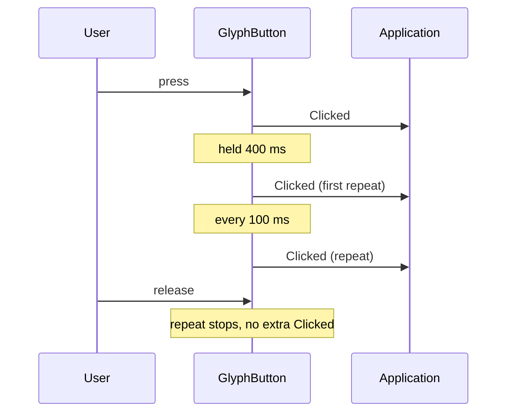

# Glyph Button

`GlyphButton` (module `pushrod_widgets::glyph_button`): a small button showing one character, used for scroll arrows, close boxes, and spin buttons. It fills its background, draws the glyph centered, and draws a one-pixel border; while pressed, its colors are inverted.


## Creating it

```rust checked title="src/spinner.rs"
use pushrod_widgets::glyph_button::GlyphButton;

/// A fictional spin control: an up arrow and a down arrow that repeat while held.
pub fn spin_arrows() -> (GlyphButton, GlyphButton) {
    let up = GlyphButton::new('↑').at(20, 20).size(20, 20).activate_on_press();
    let down = GlyphButton::new('↓').at(20, 42).size(20, 20).activate_on_press();
    (up, down)
}
```

Register the click callback with `engine.on_click(id, ..)`, as for a `Button`.

| Setter | Type | Default | Meaning |
|---|---|---|---|
| `GlyphButton::new(glyph)` | `char` | required | The character shown. |
| `at(x, y)` | `i32`, `i32` | `0, 0` | Upper left-hand corner, relative to the parent. |
| `size(w, h)` | `u32`, `u32` | `24, 24` | Width and height in pixels. |
| `font(font)` | `Font` | default font | The glyph's font. |
| `font_color(color)` | `Color` | black | The glyph's color. |
| `activate_on_press()` | none | off | Fires on press and repeats while held (sets `Behavior::ACTIVATE_ON_PRESS`). |

## Methods

| Method | Does |
|---|---|
| `set_glyph(glyph)` | Sets the character and invalidates the widget (only when it changed). |
| `get_glyph()` | Returns the character. |
| `is_selected()` | `true` while the button is drawn pressed. |

## Common methods

Every widget also has the methods of the `Widget` trait: `get_id`, `get_parent`, `get_origin`/`set_origin`, `get_size`/`set_size`, `get_color`/`set_color`, `is_hidden`/`set_hidden`, and `is_invalidated`/`set_invalidated`. See [Creating widgets](../guides/creating-widgets.md).

## Events and callbacks

| Event | Emitted when | Callback |
|---|---|---|
| `Clicked { id, button, count }` | On release inside the button; with `activate_on_press`, on press and then on each repeat | `on_click(id, ..)` |

It also re-emits `PointerPressed`, `PointerReleased`, `PointerEntered` and `PointerExited`, so `on_press`, `on_release` and `on_hover` work as they do for a [Button](button.md). Like every widget it can still receive application-defined custom events in `handle_event`.

## How the repeat works



## Notes

- Pressing selects (inverts) the button. Dragging out of its bounds deselects it and **pauses** the repeat; dragging back in selects it and resumes it.
- The repeat is driven by the core's animation ticks (`Event::Tick`), so the application needs no timer. The delay and interval are the public constants `REPEAT_DELAY` (400 ms) and `REPEAT_INTERVAL` (100 ms).
- Without `activate_on_press` it behaves like a [Button](button.md): `Clicked` is emitted when the mouse button is released inside it.
- The arrow characters `←` `↑` `→` `↓` (U+2190 to U+2193) are drawn as flat filled triangles, so they look the same whatever font is loaded (the built-in font has no arrows). Any other character is drawn with the font.
- The fill is transparent until set with `set_color`.

## Planned

Button behaviors shared with [Button](button.md) (default, cancel, toggle, dismiss dialog; see the [roadmap](https://github.com/KenSuenobu/rust-pushrod/blob/main/docs/ROADMAP_EXTENSIBLE_WIDGET_LIBRARY.md)).
