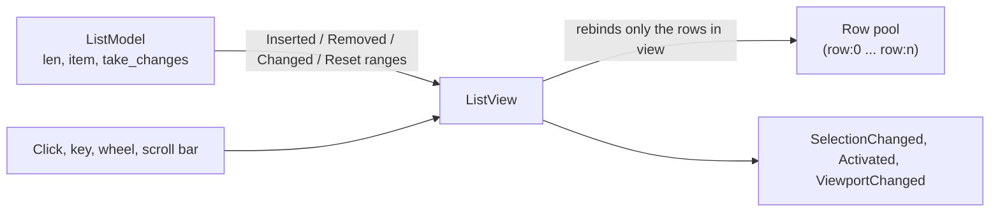

# List View

`ListView` (module `pushrod_widgets::list_view`): a scrolling list of text rows from a `ListModel`. It handles single, range, and multiple selection, the keyboard, type-ahead, and activation. File choosers, combo boxes, and most applications need one.

It is a [composite widget](../guides/composite-widgets.md). It keeps a small pool of row widgets, enough to fill its height, and rebinds them to the model as it scrolls. A list of 10,000 rows (or 10,000,000) costs as much as a list of ten.




## Creating it

Give the list a model, then position and size it. `VecModel` is a ready-made model of strings.

```rust checked title="src/fruit.rs"
use pushrod::engine::Engine;
use pushrod::geometry::size;
use pushrod_widgets::list_view::{ListView, SelectionMode, VecModel};

/// A multiple-selection list of fictional fruit.
pub fn fruit() -> Engine<()> {
    let mut engine: Engine<()> = Engine::new(size(400, 300), 30);

    engine.add_widget(
        ListView::new(VecModel::new(["Apple", "Banana", "Cherry", "Date", "Elderberry"]))
            .at(20, 20)
            .size(200, 100)
            .selection_mode(SelectionMode::Multiple),
    );
    engine
}
```

| Setter | Type | Default | Meaning |
|---|---|---|---|
| `ListView::new(model)` | `impl ListModel` | required | The rows. |
| `at(x, y)` | `i32`, `i32` | `0, 0` | The upper left-hand corner, relative to the parent. |
| `size(width, height)` | `u32`, `u32` | `200, 200` | The size, including the scroll bar. Also sizes the row pool to the height. |
| `selection_mode(mode)` | `SelectionMode` | `Single` | `Single`, `Range`, or `Multiple`. See [Selection](#selection). |
| `row_height(pixels)` | `u32` | `20` | The height of each row. Call it before `size`. |
| `max_visible_rows(rows)` | `usize` | the height's rows | Reserve a larger pool so the list can be made taller later. |
| `type_ahead_timeout(duration)` | `Duration` | 1 second | The pause that starts a new type-ahead search. |
| `row_style(callback)` | `Fn(usize) -> RowStyle` | none | Styles each row from the model. See [Styling rows](#styling-rows). |

## The model

A `ListModel` gives the length and each row's text, and reports its changes as ranges, so the list adjusts its selection and scroll position instead of starting over.

```rust checked title="src/model.rs"
use pushrod_widgets::list_view::{ListModel, ModelChange};

/// A million rows that are never stored: each is worked out when the list asks for it.
pub struct Numbers;

impl ListModel for Numbers {
    fn len(&self) -> usize {
        1_000_000
    }

    fn item(&self, index: usize) -> String {
        format!("Number {}", index + 1)
    }

    /// This model never changes. A model that does returns what changed since the last call.
    fn take_changes(&mut self) -> Vec<ModelChange> {
        Vec::new()
    }
}
```

| `ModelChange` | Meaning | The list |
|---|---|---|
| `Inserted(range)` | Rows were inserted; the range is where they are now. | Moves the selection and the view down so what was shown stays shown. |
| `Removed(range)` | Rows were removed; the range is where they were. | Drops the selection inside the range and moves the rest up. |
| `Changed(range)` | The text of rows changed. | Repaints the rows in view. The selection is kept. |
| `Reset` | Everything changed. | Clears the selection and scrolls to the top. |

Change the model through the list, so it reads the changes before the next frame:

```rust checked title="src/add_row.rs"
use pushrod::engine::Engine;
use pushrod::geometry::size;
use pushrod_widgets::button::Button;
use pushrod_widgets::list_view::{ListView, VecModel};

/// A button that adds a fictional row at the top of the list.
pub fn add_row() -> Engine<()> {
    let mut engine: Engine<()> = Engine::new(size(400, 300), 30);
    let list = engine.add_widget(ListView::new(VecModel::new(["Apple"])).at(20, 60).size(200, 100));
    let button = engine.add_widget(Button::new("Add").at(20, 20).size(80, 24));

    engine.on_click(button, move |_state, ui| {
        if let Some(model) = ui.get_mut::<ListView>(list).and_then(|l| l.model_mut::<VecModel>()) {
            model.insert(0, "Fig");
        }
    });
    engine
}
```

## Selection

| Mode | A click | Shift-click or Shift+arrow | Ctrl-click (Command on macOS) |
|---|---|---|---|
| `Single` | Selects that row. | Same as a click. | Same as a click. |
| `Range` | Selects that row; it becomes the anchor. | Selects from the anchor to the row. | Same as a click. |
| `Multiple` | Selects that row; it becomes the anchor. | Selects from the anchor to the row. | Toggles that row; it becomes the anchor. |

Read the selection after `SelectionChanged`:

```rust checked title="src/selected.rs"
use pushrod::engine::Engine;
use pushrod::geometry::size;
use pushrod_widgets::list_view::{ListView, SelectionMode, VecModel};

/// The application state: the rows last selected.
#[derive(Default)]
pub struct Picked {
    pub rows: Vec<usize>,
    pub opened: u32,
}

/// Records the selection, and counts double-clicks and Return.
pub fn picked() -> Engine<Picked> {
    let mut engine: Engine<Picked> = Engine::new(size(400, 300), 30);
    let list = engine.add_widget(
        ListView::new(VecModel::new(["Apple", "Banana", "Cherry"]))
            .at(20, 20)
            .size(200, 100)
            .selection_mode(SelectionMode::Range),
    );

    engine.on_selection_change(list, move |picked, ui| {
        if let Some(l) = ui.get::<ListView>(list) {
            picked.rows = l.selected_rows();
        }
    });
    engine.on_activate(list, |picked, _ui| picked.opened += 1);
    engine
}
```

## Methods

| Method | Does |
|---|---|
| `selected_rows()` | The selected model rows, in ascending order. |
| `is_selected(row)` | Whether a row is selected. |
| `select(row)` | Selects one row and scrolls it into view. |
| `select_range(rows)` | Selects a range (the first row only in single mode). |
| `clear_selection()` | Clears the selection. |
| `cursor_row()` | The row that has the keyboard cursor. |
| `top_row()` / `scroll_to_row(row)` | The first visible row, and scrolling to make another the first. |
| `visible_rows()` / `row_count()` | How many rows fit, and how many the model has. |
| `row_origin(row)` | Where a row in view starts, in the list's own coordinates. |
| `get_selection_mode()` / `set_selection_mode(mode)` | The selection mode. |
| `get_row_height()` / `set_row_height(pixels)` | The row height. |
| `model::<M>()` / `model_mut::<M>()` | The model as its own type. `model_mut` schedules the list to read the changes the model reports. |
| `apply_change(change)` | Tells the list about a change a model cannot report itself. |
| `typed_parts()` | The parts, as a `ListViewParts` (from the `TypedParts` trait). |

Changing the selection or the scroll position from code emits nothing; only the user does.

## Common methods

Every widget also has the methods of the `Widget` trait: `get_id`, `get_parent`, `get_origin`/`set_origin`, `get_size`/`set_size`, `get_color`/`set_color`, `is_hidden`/`set_hidden`, `is_enabled`/`set_enabled`, and `is_invalidated`/`set_invalidated`. See [Creating widgets](../guides/creating-widgets.md). `row_height` is also a [property](../forms/property-introspection.md).

## Parts

| Name | Field of `ListViewParts` | Widget | Default look |
|---|---|---|---|
| `"row:0"`, `"row:1"`, ... | `rows` | `ListRow` | White with black text; a selected row is black with white text; the keyboard cursor has a one-pixel inner border while the list is focused. The first `visible_rows()` show rows; the rest are hidden. |
| `"scroll"` | `scroll` | [`ScrollBar`](scroll-bar.md) | Along the right edge. Hidden when every row fits. |

The row widgets are recycled. A row you restyle with `set_color` or `set_style` keeps that style for whatever model row it next shows. To style by model row, use a `row_style` callback.

### Styling rows

`row_style` runs when a row is bound to the model, never for rows out of view. Return only the fields you want to change:

```rust checked title="src/styled.rs"
use pushrod::color::Color;
use pushrod::engine::Engine;
use pushrod::geometry::size;
use pushrod_widgets::list_view::{ListView, RowStyle, VecModel};

/// Every other row has a pale background; "Overdue" rows are red.
pub fn styled() -> Engine<()> {
    let mut engine: Engine<()> = Engine::new(size(400, 300), 30);
    let items = ["Pay rent", "Overdue: library book", "Water plants", "Overdue: call"];
    let overdue: Vec<bool> = items.iter().map(|s| s.starts_with("Overdue")).collect();

    engine.add_widget(
        ListView::new(VecModel::new(items))
            .at(20, 20)
            .size(240, 100)
            .row_style(move |row| RowStyle {
                color: overdue.get(row).copied().unwrap_or(false).then_some(Color::RGB(180, 0, 0)),
                background: (row % 2 == 1).then_some(Color::RGB(240, 240, 240)),
                ..RowStyle::default()
            }),
    );
    engine
}
```

## Events and callbacks

| Event | Emitted when | Callback |
|---|---|---|
| `Event::SelectionChanged { id }` | The user (or a model change) changes the selection. Read it with `selected_rows()`. | `engine.on_selection_change(id, ..)` |
| `Event::Activated { id }` | Double-click on a row, or Return with a cursor row. | `engine.on_activate(id, ..)` |
| `Event::ViewportChanged { id, offset }` | The list scrolls. `offset.y` is the first visible row. | `engine.on_viewport_change(id, ..)` |

## How it responds

| Input | Does |
|---|---|
| Click | Selects the row. |
| Double-click | Selects the row and activates. |
| Shift-click, Ctrl-click | Extends or toggles the selection (see [Selection](#selection)). |
| Wheel, one notch | Scrolls three rows. |
| Up / Down | Moves the cursor and the selection one row. Shift extends. |
| Page Up / Page Down | Moves by a page less one row. |
| Home / End | To the first or the last row. |
| Return | Activates the cursor row. |
| Ctrl+A (Command+A) | Selects every row, except in single mode. |
| Letters | Jumps to the next row that starts with the letters typed in quick succession; a pause starts a new search. |

## Notes

- **The list needs the keyboard focus for keys.** A click on a row focuses it.
- **The pool is sized when the list is created.** If the list will grow taller than its first height, reserve rows with `max_visible_rows`. A taller list than its pool shows only the pool's rows.
- **Rows are one line of text with a fixed height.** Longer text is shortened with an ellipsis.
- **Model changes are read before the next frame.** Change a `VecModel` through `model_mut`, or call `apply_change` for a model that cannot report its own changes.
- **Type-ahead is case-insensitive** and matches the start of the row's text.
- Shift-click and Ctrl-click need the backend to report the modifier keys (see [Backends](../platforms/backends.md)); the SDL2 backend does.

## Try it

`cargo run -p pushrod-widgets --example list_view` drives a 10,000-row list headlessly and prints what it does. The gallery has a List View tile: `cargo run -p pushrod-sdl2 --example gallery`.
