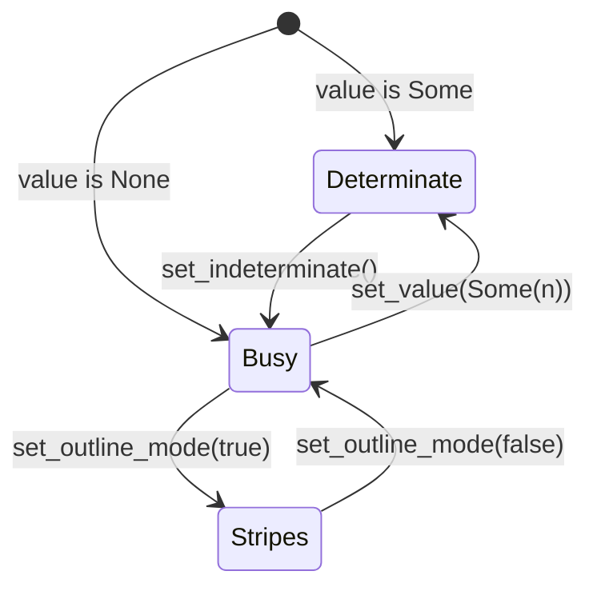

# Progress Bar

`ProgressBar` (module `pushrod_widgets::progress_bar`): a display-only bar with the same semantics as the HTML `<progress>` element. With a value between `0` and `max` it is *determinate*: a black fill covers `value / max` of a white track. With no value it is *indeterminate*: a black block sweeps back and forth to show the application is busy.


## Creating it

```rust checked title="src/download.rs"
use pushrod_widgets::progress_bar::ProgressBar;

/// A fictional download: one bar at 40%, and one for work of unknown length.
pub fn download_bars() -> (ProgressBar, ProgressBar) {
    let known = ProgressBar::new(100.0).at(20, 20).size(200, 16).value(40.0);
    let unknown = ProgressBar::indeterminate().at(20, 50).size(200, 16);
    (known, unknown)
}
```

Update a determinate bar from your own code, often from a [custom event](../events/custom-events.md), with `set_value(Some(n))`:

```rust checked title="src/update.rs"
use pushrod_widgets::progress_bar::ProgressBar;

/// Moves a bar to 75 and then makes it busy.
pub fn update(bar: &mut ProgressBar) {
    bar.set_value(Some(75.0));
    bar.set_indeterminate();
}
```

| Setter | Type | Default | Meaning |
|---|---|---|---|
| `ProgressBar::new(max)` | `f64` | required | The value at which the bar is full; starts at value `0`. |
| `ProgressBar::indeterminate()` | none | none | A busy bar with a maximum of `1.0`. |
| `at(x, y)` | `i32`, `i32` | `0, 0` | Upper left-hand corner, relative to the parent. |
| `size(w, h)` | `u32`, `u32` | `200, 16` | Width and height in pixels. |
| `value(n)` | `f64` | `0` | Starts at this value. |

## Methods

| Method | Does |
|---|---|
| `get_value()` / `set_value(Option<f64>)` | The value; `None` is indeterminate. Invalidates the bar and emits nothing. |
| `set_indeterminate()` / `is_indeterminate()` | Same as `set_value(None)`; whether the bar is busy. |
| `max()` / `set_max(f64)` | The value at which the bar is full. |
| `fraction()` | How full it is, from `0.0` to `1.0` (`None` when busy). |
| `set_outline_mode(bool)` / `is_outline_mode()` | The static look, below. |
| `is_animating()` | `true` while it is busy and not in outline mode. |

## Starting the animation

The busy block is moved by the core's animation ticks, so it needs no timer. A widget cannot start its own animation, so after you add a busy bar, or switch a bar to busy, ask for the first tick; the bar then keeps asking by itself until it stops being busy:

```rust checked title="src/start.rs"
use pushrod::engine::Engine;
use pushrod::geometry::size;
use pushrod_widgets::progress_bar::ProgressBar;

/// Adds a busy bar and starts its animation.
pub fn add_busy_bar() -> Engine<()> {
    let mut engine: Engine<()> = Engine::new(size(300, 100), 30);
    let id = engine.add_widget(ProgressBar::indeterminate().at(20, 20));

    engine.widgets().request_animation(id);
    engine
}
```

Inside event handling, call `ctx.request_animation()` instead.

## Events and callbacks

None. The bar is display only: it takes no input and emits no events, and the animation fires no callbacks.

## How it is drawn



## Notes

- A value below `0` or above `max` is drawn as empty or full. A value that is not a number, or a `max` that is not a positive, finite number, draws an empty bar.
- The block takes 1.5 seconds (`SWEEP`) to cross the bar in each direction and is a quarter of the track wide.
- In **outline mode** a busy bar is drawn as static black stripes and stops asking for ticks, so it costs nothing. A determinate bar looks the same in both modes. Today the application calls `set_outline_mode`; the drawing-mode switch of [issue 10.1](https://github.com/KenSuenobu/rust-pushrod/issues/105) will call it for every bar.
- Colors set with `set_style` override the frame (`border_color`) and the fill (`foreground`).

## Planned

A small inline spinner for work of unknown length is the [busy spinner issue](https://github.com/KenSuenobu/rust-pushrod/issues/128); see the [roadmap](https://github.com/KenSuenobu/rust-pushrod/blob/main/docs/ROADMAP_EXTENSIBLE_WIDGET_LIBRARY.md).
