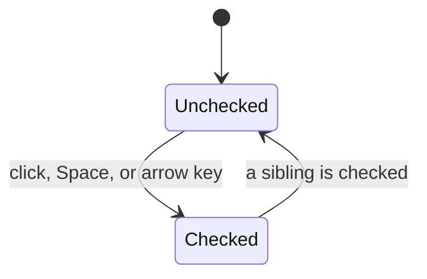

# Radio Button

`RadioButton` (module `pushrod_widgets::radio_button`): a circle followed by a label. A checked radio button shows a dot in the circle. The radio buttons that share a parent form a **group**: checking one clears the others, so a group always has one checked member once any has been chosen. `RadioGroup` builds a labeled column of them in one call.


## Creating it

```rust checked title="src/options.rs"
use pushrod::cache::WidgetCache;
use pushrod::widget::WidgetId;
use pushrod_widgets::radio_button::RadioGroup;

/// A fictional size picker: three radio buttons under `form`, Medium checked.
pub fn size_picker(cache: &mut WidgetCache, form: WidgetId) -> Vec<WidgetId> {
    RadioGroup::new(["Small", "Medium", "Large"])
        .at(20, 40)
        .selected(1)
        .add_to(cache, form)
}
```

Or add single buttons yourself; the buttons added to the same parent are one group:

```rust checked title="src/options.rs"
use pushrod_widgets::radio_button::RadioButton;

/// Two radio buttons for a fictional delivery option.
pub fn delivery() -> (RadioButton, RadioButton) {
    let pickup = RadioButton::new("Pickup").at(20, 20).checked(true);
    let post = RadioButton::new("Post").at(20, 44);
    (pickup, post)
}
```

Listen for changes with `engine.on_toggle(id, |state, ui, checked| ..)`, and ask which member is checked with `ui.checked_in_group(parent)`.

| Setter | Type | Default | Meaning |
|---|---|---|---|
| `RadioButton::new(label)` | `impl Into<String>` | required | The text after the circle. |
| `at(x, y)` | `i32`, `i32` | `0, 0` | Upper left-hand corner, relative to the parent. |
| `size(w, h)` | `u32`, `u32` | `150, 20` | Width and height in pixels. |
| `font(font)` | `Font` | default font | The label's font. |
| `font_color(color)` | `Color` | black | The label's color. |
| `checked(bool)` | `bool` | `false` | Starts checked. Check at most one per group. |

| `RadioGroup` setter | Type | Default | Meaning |
|---|---|---|---|
| `RadioGroup::new(labels)` | iterator of `impl Into<String>` | required | One radio button per label, top to bottom. |
| `at(x, y)` | `i32`, `i32` | `0, 0` | Upper left-hand corner of the first button. |
| `item_size(w, h)` | `u32`, `u32` | `150, 20` | Size of each button. |
| `gap(px)` | `u32` | `4` | Vertical gap between buttons. |
| `selected(index)` | `usize` | `0` | Which button starts checked. |
| `none_selected()` | none | off | Starts with none checked. |
| `add_to(cache, parent)` | `&mut WidgetCache`, `WidgetId` | required | Adds the buttons under `parent`; returns their IDs in label order. |

## Methods

| Method | Does |
|---|---|
| `is_checked()` / `set_checked(bool)` | The checked state. `set_checked` emits no event and does not clear siblings. |
| `set_text(text)` / `get_text()` | The label. |
| `is_pressed()` | `true` while the mouse button is down on it. |
| `select(ctx)` | Checks it as a click would and emits `Toggled`. Does nothing if already checked. |
| `ui.checked_in_group(parent)` | The ID of the checked radio button among `parent`'s children, or `None`. Also on `WidgetCache`. |

## Common methods

Every widget also has the methods of the `Widget` trait: `get_id`, `get_parent`, `get_origin`/`set_origin`, `get_size`/`set_size`, `get_color`/`set_color`, `is_hidden`/`set_hidden`, `is_enabled`/`set_enabled`, and `is_invalidated`/`set_invalidated`. See [Creating widgets](../guides/creating-widgets.md).

## Events and callbacks

| Event | Emitted when | Callback |
|---|---|---|
| `Event::Toggled { id, checked: true }` | The radio button is clicked (circle or label), Space is pressed while it has focus, or an arrow key moves the group's focus to it. | `engine.on_toggle(id, ..)` |
| `Event::Toggled { id, checked: false }` | Another radio button in its group was checked, which cleared this one. Emitted right after the `Toggled` that caused it. | `engine.on_toggle(id, ..)` |
| `Event::FocusGained` / `FocusLost { id }` | Keyboard focus moves to or from it. | `engine.on_focus_change(id, ..)` |

## How it works



Checking is done by the widget; clearing the siblings is done by the core. When a widget that has the `EXCLUSIVE` behavior emits `Toggled { checked: true }`, the core clears every other checked `EXCLUSIVE` sibling under the same parent and emits `Toggled { checked: false }` for each. This works for any widget with `EXCLUSIVE`, not only `RadioButton`.

## Keyboard

| Key | Does |
|---|---|
| Tab / Shift-Tab | Visits the group once, at its checked member (or its first, if none is checked). |
| Down, Right | Moves to the next member and checks it, wrapping from the last to the first. |
| Up, Left | Moves to the previous member and checks it, wrapping from the first to the last. |
| Space | Checks the focused member. |

## Notes

- Clicking **anywhere** on the widget, label included, checks it. The click only counts if the mouse button is released while still over it; dragging off cancels it.
- Clicking a checked radio button does nothing: a radio button is cleared only by choosing another.
- While the mouse button is held down the circle is drawn inverted: black, with the dot (if any) in white.
- A disabled radio button cannot be clicked or focused, and is drawn dimmed by the core. Arrow keys skip it.
- Group membership is the parent. To make two separate groups, put each group's buttons in a different parent, such as a `Panel` or a `GroupBox`.
- `RadioButton::checked(true)` and `set_checked(true)` do not clear siblings; use them to set the starting state, with at most one checked member per group.

## Planned

This widget does not declare a mnemonic yet. Put a `_` in a [Text](text.md) label beside it to give it one: Alt plus the letter focuses it. See [Keyboard mnemonics](../concepts/keyboard-mnemonics.md).
