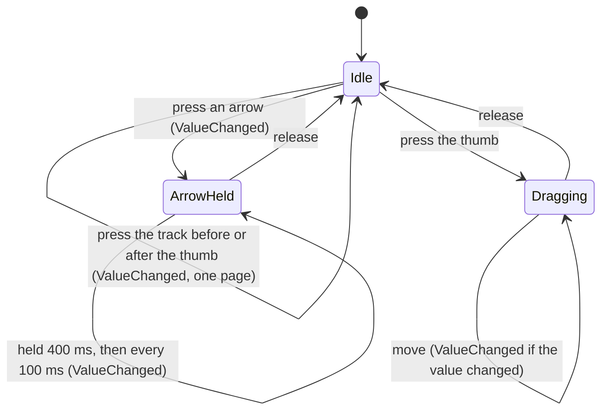

# Scroll Bar

`ScrollBar` (module `pushrod_widgets::scroll_bar`): a vertical or horizontal scroll bar. It has two arrow buttons that repeat while held, a track that pages when clicked, and a thumb you can drag. The thumb's length shows how much of the content is visible. The value runs from `0.0` (top, or left) to `1.0` (bottom, or right).

It is a [composite widget](../guides/composite-widgets.md). Its arrows, track, and thumb are ordinary widgets with their own IDs, and an application can find and restyle each one.


## Creating it

```rust checked title="src/scrolling.rs"
use pushrod_widgets::scroll_bar::ScrollBar;

/// A fictional list's vertical scroll bar (30 of 120 rows visible) and a timeline's horizontal one.
pub fn bars() -> (ScrollBar, ScrollBar) {
    let mut rows = ScrollBar::vertical().at(380, 10).size(16, 280);
    rows.set_proportion(30.0, 120.0);

    let timeline = ScrollBar::horizontal()
        .at(10, 300)
        .size(360, 16)
        .page_size(0.5)
        .step(0.1)
        .value(0.25);
    (rows, timeline)
}
```

Listen for changes with the engine, and read the new value:

```rust checked title="src/listen.rs"
use pushrod::engine::Engine;
use pushrod::geometry::size;
use pushrod_widgets::scroll_bar::ScrollBar;

/// The application state: the first row shown in a fictional list of 120 rows.
#[derive(Default)]
pub struct List {
    pub first_row: u32,
}

/// Scrolls the list when the scroll bar moves.
pub fn listen() -> Engine<List> {
    let mut engine: Engine<List> = Engine::new(size(400, 300), 30);
    let id = engine.add_widget(ScrollBar::vertical().at(380, 10).size(16, 280).page_size(0.25));

    engine.on_value_change(id, move |list, ui| {
        if let Some(bar) = ui.get::<ScrollBar>(id) {
            // 30 rows are visible, so the first row runs from 0 to 90.
            list.first_row = (bar.get_value() * 90.0).round() as u32;
        }
    });
    engine
}
```

| Setter | Type | Default | Meaning |
|---|---|---|---|
| `ScrollBar::vertical()` / `ScrollBar::horizontal()` | none | required | The direction. A vertical bar is 16 by 200 pixels and a horizontal one 200 by 16. |
| `at(x, y)` | `i32`, `i32` | `0, 0` | Upper left-hand corner, relative to the parent. |
| `size(w, h)` | `u32`, `u32` | see above | Width and height in pixels. The arrows are square, as long as the bar is thick. |
| `value(n)` | `f64` | `0.0` | Starting value, clamped to `0.0..=1.0`. |
| `page_size(n)` | `f64` | `0.25` | The visible fraction of the content (`visible / total`), clamped to `0.0..=1.0`. It sets the thumb's length and how far a click on the track moves. |
| `step(n)` | `f64` | `0.05` | How far an arrow moves the value. A negative step becomes `0` (the arrows do nothing). |

## Methods

| Method | Does |
|---|---|
| `get_value()` / `set_value(f64)` | The value. `set_value` clamps it, moves the thumb before the next frame, and emits no event. |
| `get_page_size()` / `set_page_size(f64)` | The visible fraction of the content. |
| `set_proportion(visible, total)` | Sets the page size from two amounts, such as 30 visible rows of 120. A total of `0` or less means everything is visible. |
| `get_step()` / `set_step(f64)` | How far an arrow moves the value. |
| `page_step()` | How far a click on the track moves the value: one page, so the content moves by the visible amount (`page_size / (1 - page_size)`), and never less than the step. |
| `track_bounds()` / `thumb_bounds()` | The track's and thumb's rectangles, in the scroll bar's own coordinates. |
| `is_vertical()` / `is_dragging()` | The current state. |
| `typed_parts()` | The parts by role, as a `ScrollBarParts` (from the `TypedParts` trait). |
| `parts()` / `part(name)` | The parts by name (from the `Composite` trait). |

## Parts

| Name | Field of `ScrollBarParts` | Widget | Default look |
|---|---|---|---|
| `"up"` | `up` | `GlyphButton` (`↑`, or `←` when horizontal), activate-on-press | White, black arrow, inverted while held |
| `"down"` | `down` | `GlyphButton` (`↓`, or `→` when horizontal), activate-on-press | White, black arrow, inverted while held |
| `"track"` | `track` | `Frame` | White with a one-pixel black border |
| `"thumb"` | `thumb` | `Frame` | Light gray with a black border; dark gray while dragged (its `PRESSED` style) |

Change a part like any other widget: find it, then use the normal API.

```rust checked title="src/restyle.rs"
use pushrod::color::Color;
use pushrod::composite::TypedParts;
use pushrod::engine::Engine;
use pushrod::geometry::size;
use pushrod::widget::Widget;
use pushrod_widgets::frame::Frame;
use pushrod_widgets::glyph_button::GlyphButton;
use pushrod_widgets::scroll_bar::ScrollBar;

/// A scroll bar with a blue thumb and plus and minus signs on its buttons.
pub fn restyled() -> Engine<()> {
    let mut engine: Engine<()> = Engine::new(size(200, 220), 30);
    let id = engine.add_widget(ScrollBar::vertical().at(10, 10));
    let parts = engine
        .widgets()
        .get_as::<ScrollBar>(id)
        .map(|bar| bar.typed_parts());

    if let Some(parts) = parts {
        if let Some(thumb) = engine.widgets().get_as_mut::<Frame>(parts.thumb) {
            thumb.set_color(Color::BLUE);
            thumb.set_border_color(Color::BLACK);
        }

        for (part, glyph) in [(parts.up, '-'), (parts.down, '+')] {
            if let Some(arrow) = engine.widgets().get_as_mut::<GlyphButton>(part) {
                arrow.set_glyph(glyph);
                arrow.set_font_color(Color::RGB(0, 0, 128));
            }
        }
    }
    engine
}
```

`GlyphButton` draws the four arrow characters `←` `↑` `→` `↓` as shapes. It draws any other glyph with its font (`set_font`).

## Common methods

Every widget also has the methods of the `Widget` trait: `get_id`, `get_parent`, `get_origin`/`set_origin`, `get_size`/`set_size`, `get_color`/`set_color`, `is_hidden`/`set_hidden`, `is_enabled`/`set_enabled`, and `is_invalidated`/`set_invalidated`. See [Creating widgets](../guides/creating-widgets.md).

## Events and callbacks

| Event | Emitted when | Callback |
|---|---|---|
| `Event::ValueChanged { id }` | The value actually changes: on each arrow press and repeat, on a click on the track, and continuously while the thumb is dragged. Read the value with `ui.get::<ScrollBar>(id)`. | `engine.on_value_change(id, ..)` |
| `Event::Clicked { id, .. }` (on an arrow part's ID) | An arrow is pressed, and again on each repeat. The scroll bar's `ValueChanged` follows it. | `engine.on_click(part_id, ..)` |
| `Engine(PartsArranged { id, placed })` | The thumb was moved to follow a new value or page size. | `engine.on_engine_event(..)` |

## How it responds



## Notes

- Pressing the thumb grabs it where you pressed, so it does not jump. A drag keeps following the pointer even when it leaves the scroll bar, and stops at the ends.
- `ValueChanged` is sent only when the value is different from before. At either end, an arrow or a click on the track emits nothing.
- The thumb is never shorter than 8 pixels (`MIN_THUMB_LENGTH`), so it can always be grabbed. With a page size of `1.0` it fills the track and cannot be dragged.
- The value is a fraction, so the scroll bar works with any content. To turn it into a position, multiply by the part that does not fit: `value * (total - visible)`.
- After `set_value` or `set_page_size`, the thumb moves when the next frame is drawn. The scroll bar asks for this with `Widget::request_arrange_parts`, which any composite can use to move its own parts.
- After resizing a scroll bar with `set_size`, call `request_arrange_parts` (or `WidgetCache::arrange_parts`) so the parts follow.
- While the scroll bar is disabled, its arrows and track do nothing.
- Pointer positions arrive in window coordinates. The scroll bar converts them with `EventCtx::origin()`.

## Planned

Scrollable containers use this scroll bar when they arrive with the [container issue](https://github.com/KenSuenobu/rust-pushrod/issues/58). Changing the scroll bar's look by theme is the distant [theming epic](https://github.com/KenSuenobu/rust-pushrod/blob/main/docs/ROADMAP_EXTENSIBLE_WIDGET_LIBRARY.md).
