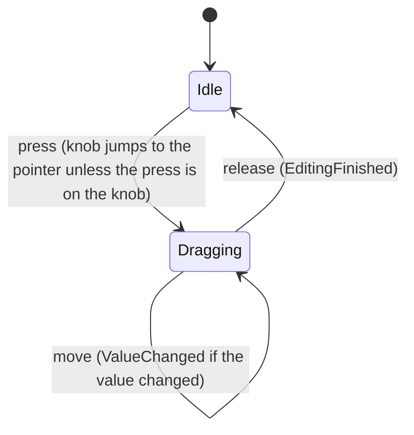

# Slider

`Slider` (module `pushrod_widgets::slider`): a knob on a track for picking a number from a range, horizontal (the default) or vertical. Drag the knob or click the track; with the keyboard focus, use the arrow keys. It can snap to a step, draw tick marks, and show its value beside the track.


## Creating it

```rust checked title="src/volume.rs"
use pushrod_widgets::slider::Slider;

/// A fictional volume control and a vertical brightness control.
pub fn controls() -> (Slider, Slider) {
    let volume = Slider::new(0.0, 100.0)
        .at(20, 20)
        .size(210, 24)
        .value(40.0)
        .step(10.0)
        .ticks(10.0)
        .show_value(true);
    let brightness = Slider::new(0.0, 100.0).vertical().at(260, 20).size(30, 108).value(75.0);
    (volume, brightness)
}
```

Listen for changes, and for the end of an edit, with the engine:

```rust checked title="src/listen.rs"
use pushrod::engine::Engine;
use pushrod::geometry::size;
use pushrod_widgets::slider::Slider;

/// The application state: the last value the slider was released at.
#[derive(Default)]
pub struct Settings {
    pub changes: u32,
    pub finished: u32,
}

/// Counts the changes and the end of each edit.
pub fn listen() -> Engine<Settings> {
    let mut engine: Engine<Settings> = Engine::new(size(300, 100), 30);
    let id = engine.add_widget(Slider::new(0.0, 100.0).at(20, 20));

    engine.on_value_change(id, move |settings, ui| {
        settings.changes += 1;
        let _ = ui.get::<Slider>(id).map(|slider| slider.get_value());
    });
    engine.on_editing_finished(id, |settings, _ui| settings.finished += 1);
    engine
}
```

| Setter | Type | Default | Meaning |
|---|---|---|---|
| `Slider::new(min, max)` | `f64`, `f64` | required | The range. Reversed bounds are swapped; a bound that is not a finite number becomes `0` (min) or `100` (max). The knob starts at `min`. |
| `at(x, y)` | `i32`, `i32` | `0, 0` | Upper left-hand corner, relative to the parent. |
| `size(w, h)` | `u32`, `u32` | `200, 24` | Width and height in pixels. Give a vertical slider a tall size. |
| `vertical()` | none | horizontal | Runs the track up and down, with the minimum at the bottom. |
| `value(n)` | `f64` | `min` | Starting value, snapped and clamped. |
| `step(n)` | `f64` | none | Values are multiples of `n` counted from `min`. `0` or less means no snapping. |
| `ticks(n)` | `f64` | none | Draws a mark every `n` value units. `0` or less draws none. |
| `show_value(bool)` | `bool` | `false` | Draws the value as text beside (horizontal) or below (vertical) the track. |
| `font(font)` / `font_color(color)` | `Font` / `Color` | default font, black | The value text. |

## Methods

| Method | Does |
|---|---|
| `get_value()` / `set_value(f64)` | The value. `set_value` snaps and clamps it, invalidates the slider, and emits no event. |
| `range()` / `set_range(min, max)` | The range; the value is kept inside it. |
| `get_step()` / `set_step(f64)` | The step; the value is re-snapped. |
| `value_text()` | The value as drawn: a whole number has no decimals, otherwise up to two. |
| `snap(f64)` | The value a given number would become: clamped, then snapped. |
| `position_of(value)` / `value_at(position)` | Convert between a value and a coordinate along the track. |
| `knob_bounds()` | The knob's rectangle, in the slider's own coordinates. |
| `key_step()` | How far an arrow key moves: the step, or a hundredth of the range. |
| `is_pressed()` / `is_vertical()` / `shows_value()` | The current state. |

## Common methods

Every widget also has the methods of the `Widget` trait: `get_id`, `get_parent`, `get_origin`/`set_origin`, `get_size`/`set_size`, `get_color`/`set_color`, `is_hidden`/`set_hidden`, `is_enabled`/`set_enabled`, and `is_invalidated`/`set_invalidated`. See [Creating widgets](../guides/creating-widgets.md).

## Events and callbacks

| Event | Emitted when | Callback |
|---|---|---|
| `Event::ValueChanged { id }` | The value actually changes: continuously while dragging, on a click on the track, and on each key press. Read the value with `ui.get::<Slider>(id)`. | `engine.on_value_change(id, ..)` |
| `Event::EditingFinished { id }` | The mouse button is released after a click or drag. Keys do not emit it. | `engine.on_editing_finished(id, ..)` |
| `Event::FocusGained` / `FocusLost { id }` | Keyboard focus moves to or from it. | `engine.on_focus_change(id, ..)` |

## Keys

With the keyboard focus (click it, or Tab to it):

| Key | Does |
|---|---|
| Left, Down | Down by one key step. |
| Right, Up | Up by one key step. |
| Page Down, Page Up | Down or up by ten key steps. |
| Home, End | Jump to the minimum or the maximum. |

## How the mouse works



## Notes

- Pressing **on the knob** grabs it where you pressed, so it does not jump; pressing **on the track** moves the knob's center to the pointer. A drag keeps following the pointer even when it leaves the widget, and clamps to the ends.
- While the mouse button is down the knob is drawn inverted (black).
- `ValueChanged` is sent only when the value is different from before, so pressing where the knob already is, or pushing a key at the end of the range, emits nothing.
- Ticks only draw marks. To snap to them, give the slider the same `step`.
- Showing the value shortens the track to make room for the text.
- Colors set with `set_style` override the background, the frame and track (`border_color`), and the value text (`foreground`). The focus outline and the dimmed look of a disabled slider are drawn by the core.
- Pointer positions arrive in window coordinates; the slider converts them with `EventCtx::origin()`, the window position of the widget handling the event.

## Planned

This widget does not declare a mnemonic yet. Put a `_` in a [Text](text.md) label beside it to give it one: Alt plus the letter focuses it. See [Keyboard mnemonics](../concepts/keyboard-mnemonics.md).
