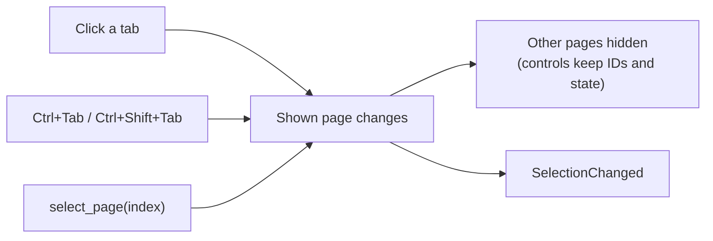

# Tab View

`TabView` (module `pushrod_widgets::tab_view`): a strip of tabs above a stack of pages, with one page shown at a time. Settings dialogs use it to group many controls into pages.

It is a [composite widget](../guides/composite-widgets.md). Each page is a `Panel` and each tab is a toggle `Button`, all with their own IDs, so you add controls to a page and restyle a tab with the normal API.




## Creating it

Queue the pages with `with_page`, then add the view to the window. Controls go into a page with `add_child_widget(page, ..)`.

```rust checked title="src/settings.rs"
use pushrod::engine::Engine;
use pushrod::geometry::size;
use pushrod_widgets::check_box::CheckBox;
use pushrod_widgets::tab_view::TabView;

/// A fictional settings dialog with two pages.
pub fn settings() -> Engine<()> {
    let mut engine: Engine<()> = Engine::new(size(400, 300), 30);
    let tabs = engine.add_widget(
        TabView::new()
            .at(20, 20)
            .size(300, 200)
            .with_page("General")
            .with_page("Advanced"),
    );
    let pages = engine
        .widgets()
        .get_as::<TabView>(tabs)
        .map(TabView::pages)
        .unwrap_or_default();

    if let [general, _advanced] = pages[..] {
        engine.add_child_widget(general, CheckBox::new("Check for updates").at(10, 10).size(200, 20));
    }
    engine
}
```

| Setter | Type | Default | Meaning |
|---|---|---|---|
| `TabView::new()` | | | A view with no pages, 200 by 150 pixels. |
| `at(x, y)` | `i32`, `i32` | `0, 0` | The upper left-hand corner, relative to the parent. |
| `size(width, height)` | `u32`, `u32` | `200, 150` | The size, including the 24-pixel strip of tabs. |
| `with_page(title)` | `impl Into<String>` | none | Queues a page and its tab. Call it once per page, in order. The first page is shown. |

## Switching pages

Switching **hides** the other pages; it never removes them. The controls inside a hidden page keep their IDs, values, and callbacks, and the page is not drawn, gets no mouse events, and is skipped by the Tab key. If the keyboard focus was inside the page that was hidden, it moves to the new page's tab.

The user switches pages by clicking a tab, or with **Ctrl+Tab** (next page) and **Ctrl+Shift+Tab** (previous page), wrapping around at the ends. The shortcut works while the focus is on a tab or on a control inside any page; with nothing focused there is no focus for it to start from. The tabs take the keyboard focus, so Tab reaches them, and Space or Return activates one.

## Adding and removing pages

`add_page` and `remove_page` take the window's widget cache, because they create and remove widgets:

```rust checked title="src/pages.rs"
use pushrod::engine::Engine;
use pushrod::geometry::size;
use pushrod_widgets::tab_view::TabView;

/// Adds a page, retitles it, then removes the first page.
pub fn pages() -> Engine<()> {
    let mut engine: Engine<()> = Engine::new(size(400, 300), 30);
    let tabs = engine.add_widget(TabView::new().size(300, 200).with_page("General"));

    if let Ok((_tab, _page)) = TabView::add_page(engine.widgets(), tabs, "Network") {
        let _ = TabView::set_page_title(engine.widgets(), tabs, 1, "Wi-Fi");
        let _ = TabView::remove_page(engine.widgets(), tabs, 0);
    }
    engine
}
```

Adding a page does not change the shown page. Removing the shown page shows its neighbor (the next page, or the previous one if it was last) and emits `SelectionChanged`; removing another page keeps the same page shown. Removing a page removes its tab and everything inside it.

## Methods

| Method | Does |
|---|---|
| `selected_page()` | The index of the shown page, or `None` if there are no pages. |
| `selected_page_id()` | The shown page's widget ID. |
| `select_page(index)` | Shows a page; `false` if there is no such page. Emits `SelectionChanged` at the next frame if the page changed. |
| `page_count()` | How many pages there are. |
| `tabs()` / `pages()` | The tab buttons and the page panels, in the same order. |
| `TabView::add_page(cache, view, title)` | Adds a page and returns `(tab_id, page_id)`. |
| `TabView::remove_page(cache, view, index)` | Removes a page and returns `(tab_id, page_id)`. Errors if there is no such page. |
| `TabView::set_page_title(cache, view, index, title)` | Retitles a tab and resizes it to fit. |
| `typed_parts()` | The parts, as a `TabViewParts` (from the `TypedParts` trait). |

## Common methods

Every widget also has the methods of the `Widget` trait: `get_id`, `get_parent`, `get_origin`/`set_origin`, `get_size`/`set_size`, `get_color`/`set_color`, `is_hidden`/`set_hidden`, `is_enabled`/`set_enabled`, and `is_invalidated`/`set_invalidated`. See [Creating widgets](../guides/creating-widgets.md).

## Parts

| Name | Field of `TabViewParts` | Widget | Default look |
|---|---|---|---|
| `"tab:0"`, `"tab:1"`, ... | `tabs` | [`Button`](button.md) (toggle) | A light gray tab with black text and a one-pixel black outline. The shown tab is raised, takes the page's color, and is open at the bottom so it joins the page. Each tab is as wide as its label needs. |
| `"page:0"`, `"page:1"`, ... | `pages` | [`Panel`](panel.md) | Light gray (the view's color), filling the area under the tabs inside a one-pixel black border. Only the shown page is visible. Controls you add should share its color. |

Every part can be retrieved and restyled with the usual calls, such as `ui.get_mut::<Button>(tab)` for a tab's font, color, and text, or `set_color` on a page:

```rust checked title="src/restyle.rs"
use pushrod::appearance::StateStyle;
use pushrod::color::Color;
use pushrod::engine::Engine;
use pushrod::geometry::size;
use pushrod::widget::{VisualState, Widget};
use pushrod_widgets::button::Button;
use pushrod_widgets::tab_view::TabView;

/// Makes the first tab's label blue when a button is clicked.
pub fn restyle() -> Engine<()> {
    let mut engine: Engine<()> = Engine::new(size(400, 300), 30);
    let tabs = engine.add_widget(TabView::new().size(300, 200).with_page("General"));
    let go = engine.add_widget(Button::new("Restyle").at(20, 240).size(100, 24));

    engine.on_click(go, move |_state, ui| {
        let first = ui.get::<TabView>(tabs).map(TabView::tabs).unwrap_or_default();

        if let Some(&tab) = first.first()
            && let Some(button) = ui.get_mut::<Button>(tab)
        {
            button.set_style(
                VisualState::empty(),
                StateStyle {
                    foreground: Some(Color::RGB(0, 0, 200)),
                    ..StateStyle::default()
                },
            );
        }
    });
    engine
}
```

## Events and callbacks

| Event | Emitted when | Callback |
|---|---|---|
| `Event::SelectionChanged { id }` | The shown page changes: a tab click, Ctrl+Tab, `select_page`, or a removed shown page. Read it with `selected_page()`. | `engine.on_selection_change(id, ..)` |

A new view shows page 0 without reporting a change. The tabs are buttons, so their own `Toggled` events also reach callbacks registered on a tab's ID.

## How it responds

| Input | Does |
|---|---|
| Click a tab | Shows that page and gives the tab the focus. Clicking the shown tab changes nothing. |
| Ctrl+Tab | Shows the next page, wrapping from the last to the first. |
| Ctrl+Shift+Tab | Shows the previous page, wrapping from the first to the last. |
| Tab / Shift+Tab | Moves the focus through the tabs and the shown page's controls. |

## Notes

- **Ctrl+Tab needs a focused tab or page control.** Keys go to the focused widget and up through the widgets that contain it.
- **Tab widths are estimated from the label.** Setting a tab's text directly leaves its width until the next arrangement; use `set_page_title` to resize it at once.
- **Pages are placed by the view.** Resizing the view with `set_size` takes effect the next time its parts are arranged.
- **The pages are a stack.** A dedicated stack layout is planned separately; until then the view hides and shows its page panels itself.

## Try it

`cargo run -p pushrod-widgets --example tab_view` drives a three-tab view headlessly and prints what it does. The gallery has a Tab View tile: `cargo run -p pushrod-sdl2 --example gallery`.
