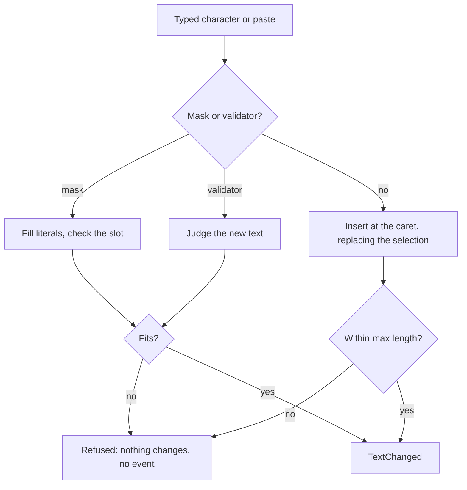

# Text Field

`TextField` (module `pushrod_widgets::text_field`): a single line of editable text. It has a blinking caret, a selection, clipboard shortcuts, a maximum length, a placeholder, and a password mode. Input can be restricted with a **mask** (`"99/99/9999"`) or a **validator**, and `IntegerField` and `NumberField` build fields that accept numbers in a range. A field can also show small glyph buttons, called **accessories**, inside its edit area.


## Creating it

```rust checked title="src/form.rs"
use pushrod_widgets::text_field::{Accessory, IntegerField, TextField};

/// A fictional sign-up form: name, date of birth, age, password and a search box.
pub fn fields() -> Vec<TextField> {
    vec![
        TextField::new().at(20, 20).size(260, 24).with_label("Name:").placeholder("Your name"),
        TextField::new().at(20, 52).size(260, 24).with_label("Born:").with_mask("99/99/9999"),
        IntegerField::range(0, 120).at(20, 84).size(260, 24).with_label("Age:"),
        TextField::new()
            .at(20, 116)
            .size(260, 24)
            .with_label("Password:")
            .password()
            .with_trailing(Accessory::RevealPassword),
        TextField::search().at(20, 148).size(260, 24),
    ]
}
```

Listen for edits with the engine, and read the text with `ui.get`:

```rust checked title="src/listen_field.rs"
use pushrod::engine::Engine;
use pushrod::geometry::size;
use pushrod_widgets::text_field::TextField;

/// The application state: the last text the user finished editing.
#[derive(Default)]
pub struct Form {
    pub name: String,
    pub edits: u32,
}

/// Counts the edits, and keeps the text when editing finishes.
pub fn listen() -> Engine<Form> {
    let mut engine: Engine<Form> = Engine::new(size(300, 100), 30);
    let id = engine.add_widget(TextField::new().at(20, 20).size(240, 24));

    engine.on_text_change(id, |form, _ui| form.edits += 1);
    engine.on_editing_finished(id, move |form, ui| {
        if let Some(field) = ui.get::<TextField>(id) {
            form.name = field.text();
        }
    });
    engine
}
```

| Setter | Type | Default | Meaning |
|---|---|---|---|
| `TextField::new()` | none | an empty field | Creates the field. |
| `TextField::search()` | none | none | The search preset: a magnifier at the leading edge, a clear button at the trailing edge, and the placeholder `Search`. |
| `IntegerField::range(min, max)` | `i64`, `i64` | required | A field that accepts only whole numbers in the range (a `-` only if the range has negatives). Read with `value_i64()`. |
| `NumberField::range(min, max, decimals)` | `f64`, `f64`, `usize` | required | A field that accepts only decimal numbers in the range, with at most `decimals` digits after the point. Read with `value_f64()`. |
| `at(x, y)` | `i32`, `i32` | `0, 0` | Upper left-hand corner, relative to the parent. |
| `size(w, h)` | `u32`, `u32` | `200, 24` | Width and height in pixels, label included. |
| `with_label(text)` | `String` | none | A label to the left of the edit area. |
| `placeholder(text)` | `String` | none | Gray text shown while the field is empty. |
| `with_text(text)` | `&str` | empty | The starting text. Skips the mask, validator and events. |
| `max_length(n)` | `usize` | none | The most characters allowed. Ignored with a mask. |
| `password()` | none | off | Draws each character as `*`; copy and cut do nothing. |
| `with_mask(template)` | `&str` | none | Restricts the text to a mask. Replaces any validator. |
| `with_validator(v)` | `impl Validator` | none | Restricts the text with your own rules. Replaces any mask. |
| `with_leading(accessory)` / `with_trailing(accessory)` | `Accessory` | none | Puts a button inside the edit area, at the left or right edge. |

## Methods

| Method | Does |
|---|---|
| `text()` | The text the user typed (never the `*` of a password). |
| `set_text(&str)` | Replaces the text, puts the caret at the end, emits no event, and skips the mask and validator. |
| `selected_text()` / `caret()` | The selection, and the caret position in characters. |
| `validity()` | `Valid`, `Intermediate` or `Invalid`, judged by the mask or validator (`Valid` with neither). |
| `value_i64()` / `value_f64()` | The text as a number, or `None`. |
| `is_revealed()` | Whether a password field is showing its characters. |

## Common methods

Every widget also has the methods of the `Widget` trait: `get_id`, `get_parent`, `get_origin`/`set_origin`, `get_size`/`set_size`, `get_color`/`set_color`, `is_hidden`/`set_hidden`, `is_enabled`/`set_enabled`, and `is_invalidated`/`set_invalidated`. See [Creating widgets](../guides/creating-widgets.md).

## Events and callbacks

| Event | Emitted when | Callback |
|---|---|---|
| `Event::TextChanged { id }` | After every edit: typing, deleting, cutting, pasting, and the clear button. Not after `set_text`, and not while an input method is composing (only when the composition is committed). | `engine.on_text_change(id, ..)` |
| `Event::EditingFinished { id }` | The user presses Return, or the field loses the keyboard focus. Validate here. | `engine.on_editing_finished(id, ..)` |
| `Event::KeyPressed { id, key, modifiers, repeat }` | A key goes down while the field has the focus. | `engine.on_key_press(id, ..)` |
| `Event::AccessoryClicked { id, which }` | A search or custom accessory is clicked; `which` is `AccessorySide::Leading` or `Trailing`. Clear and reveal act on their own and do not send it. | `engine.on_event(..)` |
| `Event::FocusGained` / `FocusLost { id }` | Keyboard focus moves to or from it. | `engine.on_focus_change(id, ..)` |

Return is not consumed, so a default button in the same dialog still activates.

## Input methods (IME)

With an input method (Chinese, Japanese, Korean, ...) the field shows the composition text underlined at the caret, and the input method's own selection with a thicker underline. The composition is not part of `text()` and sends no `TextChanged` until it is committed. A password field never shows a composition. The field reports its caret so the operating system's candidate window appears beside it and follows it. See [Text input and IME](../guides/text-input-and-ime.md).

## Keys and mouse

With the keyboard focus (click it, or Tab to it):

| Key | Does |
|---|---|
| Left, Right | Move the caret; with a selection and no Shift, collapse it to that edge. |
| Alt or Ctrl with Left, Right | Move by word. |
| Home, End | Jump to the start or end. |
| Shift with any of the above | Extend the selection. |
| Backspace, Delete | Remove a character, or the selection; with Alt or Ctrl, a word. |
| Ctrl or Command with `A` | Select all. |
| Ctrl or Command with `C`, `X`, `V` | Copy, cut, paste. |
| Return | Emits `EditingFinished`. |

| Mouse | Does |
|---|---|
| Click | Focuses the field and places the caret. |
| Drag | Selects from the press to the pointer. |
| Double click | Selects a word. |
| Triple click | Selects everything. |

## Masks and validators

A mask is a template. `9` is a digit, `A` a letter, `X` any character, and any other character is a **literal** that is filled in as you type.

| Typed into `99/99/9999` | Text becomes |
|---|---|
| `12` | `12` |
| `122` | `12/2` (the slash is filled in) |
| `12/` | `12/` (typing the literal is accepted too) |
| `1a` | `1` (the letter is refused) |

Inside a mask a typed character overwrites the one at the caret and hops over literals. Only the end of the text can be deleted.

A validator implements `Validator::validate(&str) -> Validity`:

| Result | Meaning |
|---|---|
| `Valid` | Acceptable as it stands. |
| `Intermediate` | Not acceptable yet but could become so (`1` for a range of 10 to 20). Allowed while typing. |
| `Invalid` | Can never become acceptable. The edit that produced it does not happen. |

```rust checked title="src/validator.rs"
use pushrod_widgets::text_field::TextField;
use pushrod_widgets::text_field::validate::{Validator, Validity};

/// Accepts only lowercase letters.
#[derive(Debug)]
pub struct Lowercase;

impl Validator for Lowercase {
    fn validate(&self, text: &str) -> Validity {
        if text.chars().all(|c| c.is_ascii_lowercase()) {
            Validity::Valid
        } else {
            Validity::Invalid
        }
    }
}

/// A fictional username field.
pub fn username() -> TextField {
    TextField::new().with_validator(Lowercase)
}
```

## Accessories

An `Accessory` is a square button drawn inside the edit area. The text is clipped to the room between the accessories, so it never runs underneath one.

| Accessory | Looks like | Clicking it |
|---|---|---|
| `Clear` | A white cross on a light gray disc, shown only while the field has text | Clears the text and emits `TextChanged`. |
| `Search` | A magnifier: a ring with a thick handle | Emits `AccessoryClicked`; ignore it to leave the magnifier decorative. |
| `RevealPassword` | An almond-shaped eye with a dark iris (struck through while revealed) | Shows or hides a password field's characters. |
| `Custom(char)` | The character | Emits `AccessoryClicked`. |

The pictures are drawn by hand from fills and lines (module `text_field::glyphs`), so they look the same in every font.

## How editing works



## Notes

- Losing the keyboard focus releases the selection (the caret position is kept).
- The caret blinks on the core's animation ticks (`Event::Tick`) while the field has the focus, and the field asks for the next tick itself.
- Copy and paste go through the engine to the system clipboard. The engine refreshes its copy of the clipboard while a text field has the focus.
- Positions are counted in characters, not bytes. Input-method composition arrives with [1.19](https://github.com/KenSuenobu/rust-pushrod/issues/112); plain typing works now.
- Colors set with `set_style` override the edit area's background, the border and accessories (`border_color`), and the text (`foreground`). The focus outline and the dimmed look of a disabled field are drawn by the core.
- `Event::AccessoryClicked` and `AccessorySide` are part of the core event vocabulary (see the [event reference](../events/event-reference.md)).

## Planned

This widget does not declare a mnemonic yet. Put a `_` in a [Text](text.md) label beside it to give it one: Alt plus the letter focuses it. See [Keyboard mnemonics](../concepts/keyboard-mnemonics.md).
